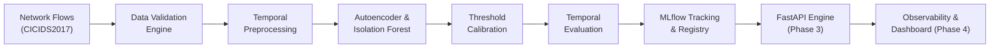

# NETDEFY — Network Defense Intelligence

> **Tagline:** Detect Anomalies. Understand Network Behaviour.  
> **Category:** AI-Powered Defensive Network Anomaly Detection Platform.

---

## 1. Product Overview

**NETDEFY** is an open-source defensive cybersecurity machine learning platform engineered to detect anomalous network traffic and characterize complex network behavior. Operating strictly within a defensive posture, NETDEFY uses statistical learning and deep autoencoders to analyze network flow metrics, establish reliable baselines of benign traffic, and flag suspicious intrusions without relying on offensive packet manipulation or brittle signature rules.

---

## 2. Problem Statement

Modern intrusion detection systems (IDS) frequently suffer from three critical flaws:
1. **Temporal Degradation:** Models evaluated on randomly shuffled train/test splits appear highly accurate in academic papers, but their detection rates collapse rapidly when deployed against real-world network traffic recorded on subsequent days.
2. **Excessive False Alarm Rates (FAR):** In high-throughput network environments carrying millions of flows daily, even a 1% false positive rate inundates security operations center (SOC) analysts with thousands of false alerts daily.
3. **Black-Box Deep Learning Assumptions:** Many implementations deploy heavy neural architectures under the untested assumption that deep learning always outperforms classical machine learning, incurring massive compute and memory penalties without measurable security benefits.

---

## 3. Proposed Solution

NETDEFY addresses these operational hurdles through:
- **Leakage-Free Temporal Partitioning:** Partitioning training and testing datasets chronologically rather than randomly to rigorously evaluate real-world decay and drift.
- **Benign Baseline Modeling:** Employing semi-supervised PyTorch Autoencoders and Isolation Forests trained strictly on normal network traffic to detect zero-day and evolving anomalies.
- **Resource-Aware Engineering:** Designed from the ground up for efficient execution on Apple Silicon (MPS) and resource-constrained environments (e.g., 8 GB unified memory), utilizing `float32` representations and chunked streaming.
- **Transparent Multi-Metric Evaluation:** Prioritizing Precision-Recall AUC (PR-AUC), attack-wise recall, false alarms per 1,000 flows, peak memory, and scoring latency over misleading raw accuracy scores.

---

## 4. Central Research Objective

Our foundational research question is:

> **"How well can a network anomaly detection model trained on earlier network traffic detect suspicious behaviour in traffic from later days?"**

Temporal generalization is the primary scientific differentiator of NETDEFY. Throughout our phased development, we investigate six core hypotheses:

1. **Temporal Generalization:** How sharply does detection performance degrade when models trained on Day $N$ are tested on Days $N+1$, $N+2$, and beyond?
2. **Behavioral Drift:** How does baseline network communication structure alter across business hours, days, and traffic volumes?
3. **Attack Discoverability:** Which attack categories (e.g., DoS, PortScan, Brute Force, Infiltration) remain detectable under temporal shift, and which rapidly evade detection?
4. **False Alarm Budgets:** How many false alerts are produced per 1,000 benign flows, and how can threshold calibration minimize alert fatigue?
5. **Architectural Comparison:** Does a PyTorch deep autoencoder actually outperform a well-tuned Scikit-Learn Isolation Forest when subjected to temporal shift?
6. **Hardware Trade-Offs:** What is the Pareto frontier between detection recall, inference latency (milliseconds per flow), and RAM consumption?

---

## 5. Technology Stack

- **Language & Runtime:** Python 3.12 (Strict typing with MyPy, Type hints throughout)
- **Machine Learning & Deep Learning:** PyTorch (Apple MPS & NVIDIA CUDA acceleration), Scikit-Learn, NumPy, Pandas
- **Experiment Tracking & Governance:** MLflow
- **API Backend (Planned Phase 3):** FastAPI, Pydantic v2, Uvicorn
- **Code Quality & Verification:** Pytest, Pytest-Cov, Ruff (linter & formatter), MyPy
- **Target Hardware:** Apple Silicon M3 (8 GB Unified Memory) with CPU/CUDA fallback

---

## 6. Architecture & Data Flow



See [docs/ARCHITECTURE.md](docs/ARCHITECTURE.md) for full architectural specifications.

---

## 7. Phased Development Roadmap

- [x] **Phase 1: Project Foundation & Engineering Architecture** (Current)
  - Modular Python architecture with strict typing and Pydantic validation.
  - Multi-tier device manager with active MPS/CUDA verification and CPU fallback.
  - Reproducibility controller for PyTorch, NumPy, and Python standard libraries.
  - Reusable dataset validation engine for schema and numerical integrity.
  - Comprehensive documentation, environment diagnostics, and CI workflows.
- [ ] **Phase 2: Data Ingestion, Preprocessing & Temporal Modeling**
  - Offline CICIDS2017 benchmark ingestion and temporal splitting.
  - Leakage-free preprocessing pipeline and feature selection.
  - Deep Autoencoder (PyTorch) and Isolation Forest implementation.
  - MLflow experiment tracking and multi-metric temporal evaluation.
- [ ] **Phase 3: Real-Time Inference Engine**
  - High-performance asynchronous FastAPI scoring endpoints.
  - Input validation with Pydantic request/response schemas.
  - Serialization and low-latency batch prediction.
- [ ] **Phase 4: Monitoring, Observability & Analytics Dashboard**
  - Real-time data drift and reconstruction error monitoring.
  - Cyber defense analytics dashboard built with React, TypeScript, and Recharts.
  - Docker containerization and complete end-to-end integration.

---

## 8. Installation & Setup

### Prerequisites
- macOS (Apple Silicon arm64) or Linux x86_64
- Python 3.12
- `uv` package manager (recommended) or `pip`

### Step 1: Clone Repository & Create Environment
```bash
# Navigate to project root
cd Netdefy

# Create Python 3.12 virtual environment using uv
uv venv --python 3.12 .venv

# Activate virtual environment
source .venv/bin/activate
```

### Step 2: Install Dependencies
```bash
# Install editable package along with development dependencies
uv pip install -e ".[dev]"
```

### Step 3: Run Environment Diagnostics
```bash
python scripts/check_environment.py
```

---

## 9. Testing & Code Quality

Run tests, linting, formatting, and strict type verification with the following commands:

```bash
# Run complete test suite with coverage
pytest --cov=netdefy --cov-report=term-missing

# Lint codebase with Ruff
ruff check .

# Check formatting with Ruff
ruff format --check .

# Run strict MyPy type checking
mypy src tests scripts
```

---

## 10. Security & Ethical Boundaries

NETDEFY is designed exclusively as a defensive research platform.
- It does not contain exploit code, malware, or attack payloads.
- It does not perform unauthorized network packet interception or port scanning.
- Predictions indicate statistical deviations and suspicious patterns; they are designated as *anomalies* or *potential intrusions*, not confirmed cyber incidents.

---

## 11. License

This project is licensed under the MIT License — see the [LICENSE](LICENSE) file for details.

