# NETDEFY — Network Threat Detection Platform & Research Workbench

> **Tagline:** Detect Anomalies. Understand Network Behaviour.  
> **Category:** Network Threat Detection Platform & Research-Grade Evaluation Workbench  
> **Status:** Open-Source AI/ML Portfolio Release & Applied Research Prototype  

[](https://github.com/Nitin-0017/Netdefy/actions/workflows/tests.yml)
[](https://www.python.org/downloads/release/python-3120/)
[](https://pytorch.org/)
[](https://fastapi.tiangolo.com/)
[](https://react.dev/)
[](https://opensource.org/licenses/MIT)

---

## 1. Project Introduction

**NETDEFY** is an applied machine learning platform that unifies a **user-facing network threat detection console** with a **reproducible AI/ML research and evaluation workbench**.

Operating strictly within a defensive posture, NETDEFY bridges the gap between academic model evaluation and operational threat detection:

1. **User-Facing Threat Detection Console (Default Interface):**
   - **Batch Ingestion via CSV:** Upload packet flow vectors, validate against the 76 continuous model features, isolate any ground-truth `Label` column (never fed to models), and execute vectorized multi-model inference.
   - **Manual Flow Vector Formulation:** Interactive input for all 76 continuous features grouped into 9 logical sections with physical units (`microseconds`, `bytes`, `packets`, `bytes/s`, `packets/s`) and 1-click loading of verified physical benchmark captures.
   - **Four-State Operational Triage:** Classifies incoming flows into `NORMAL`, `SUSPICIOUS_KNOWN`, `SUSPICIOUS_UNKNOWN`, or `REVIEW_REQUIRED`, combining supervised attack attribution with unsupervised outlier calibration and model-native feature residuals.
   - **Persistent Detection History:** Local forensic audit trail recorded to disk with flow-level inspection, aggregate statistics, and downloadable CSV analysis reports.
   - **Threat Intelligence Scope:** Transparent documentation of the 8 trained attack classes, the 7 open-set threat vectors absent from classifier training, and honest single-flow model limitations.

2. **AI/ML Research & Evaluation Workbench (Preserved):**
   - **Zero Temporal Leakage:** Models trained chronologically on Monday–Wednesday traffic and evaluated strictly on subsequent Thursday–Friday holdout traffic.
   - **Multi-Paradigm Inference:** Combines unsupervised tree ensembles (Isolation Forest), deep non-linear manifold compression (PyTorch Autoencoder), and supervised gradient boosting (XGBoost).
   - **Empirical Threshold Calibration:** Calibrates raw detector scores via empirical CDF on pure benign validation traffic ($p_{95}, p_{99}, p_{99.5}$), suppressing benign false alarms by **$46.5\%$** relative to individual anomaly detectors.
   - **Interactive Diagnostics:** Head-to-head model comparison, open-set confusion diagnostics, grounded explainability, and what-if feature sliders.

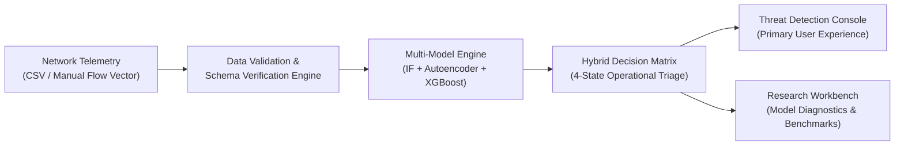

> [!NOTE]
> **Research Prototype Scope:** NETDEFY is an applied machine learning research artifact and portfolio engineering demonstration. It is not an enterprise SOC appliance, does not provide automated offensive countermeasures, and does not claim to prevent zero-day attacks without defensive human review.

---

## 2. Visual Platform Walkthrough

### 2.1 Threat Detection Console

#### Operational Overview & System Status
Displays live triage distribution, flow volume metrics, and active model status without fabricated mock telemetry.
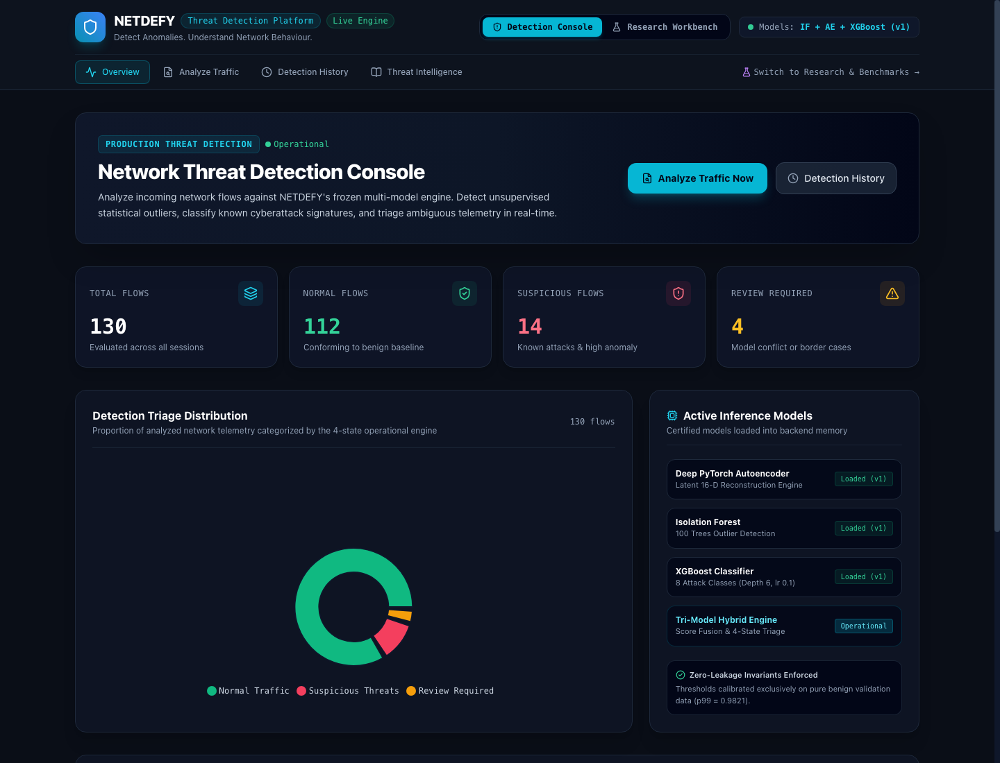

#### Traffic Analysis & Batch Ingestion (CSV Mode)
Uploads network flow telemetry, validates 76 continuous features, previews data, and runs batch multi-model inference.
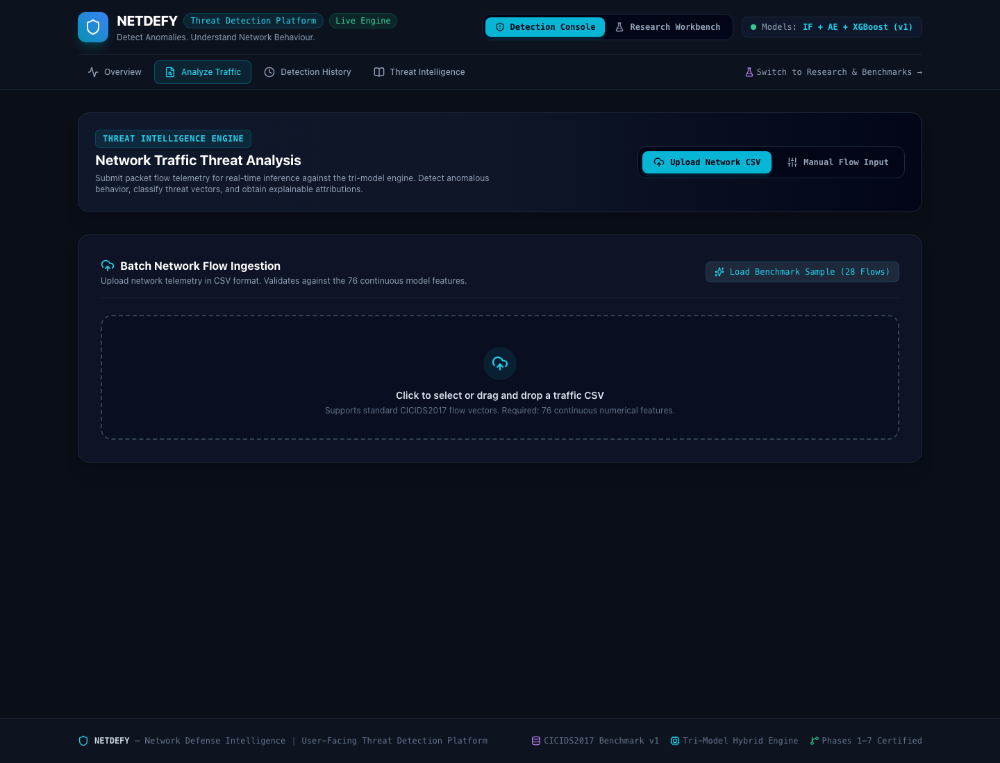

#### Manual Flow Vector Formulation (76 Continuous Features)
Enables per-flow input grouped into 9 physical categories with instant 1-click loading of verified benchmark flows.
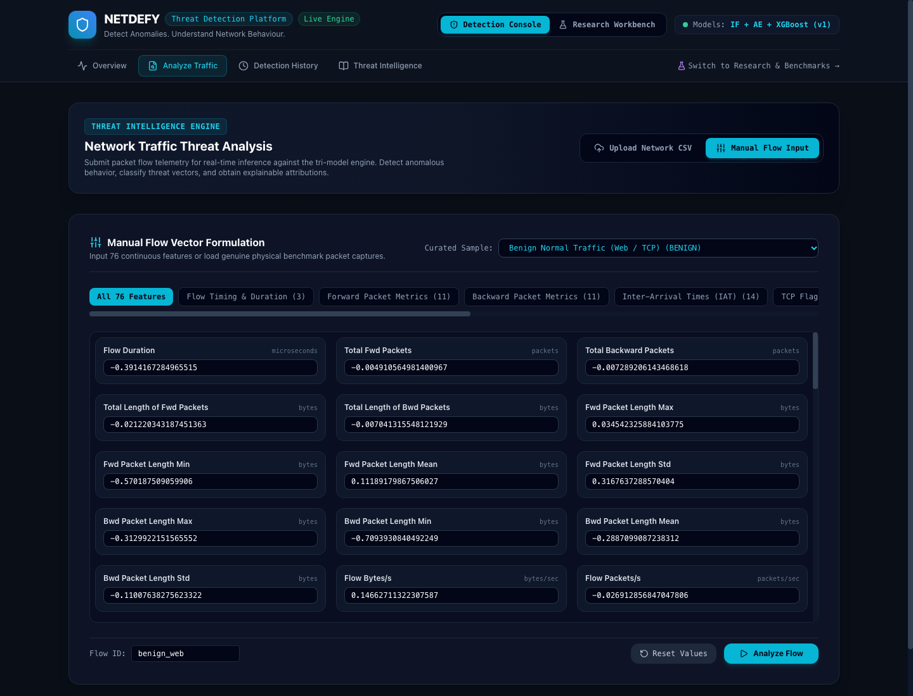

#### Detection Assessment & Attack Attribution Output
Detailed 4-state triage decision with plain-English operational assessment, supervised attack attribution with class confidence, unsupervised outlier calibration, and top diagnostic feature residuals.
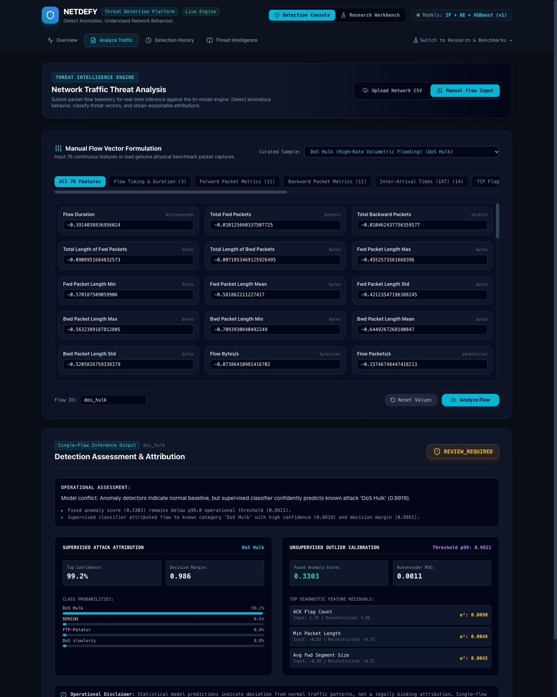

#### Forensic Detection History & Audit Log
Persistent archive of past analyses with session summaries, flow-level inspection, and CSV report export.
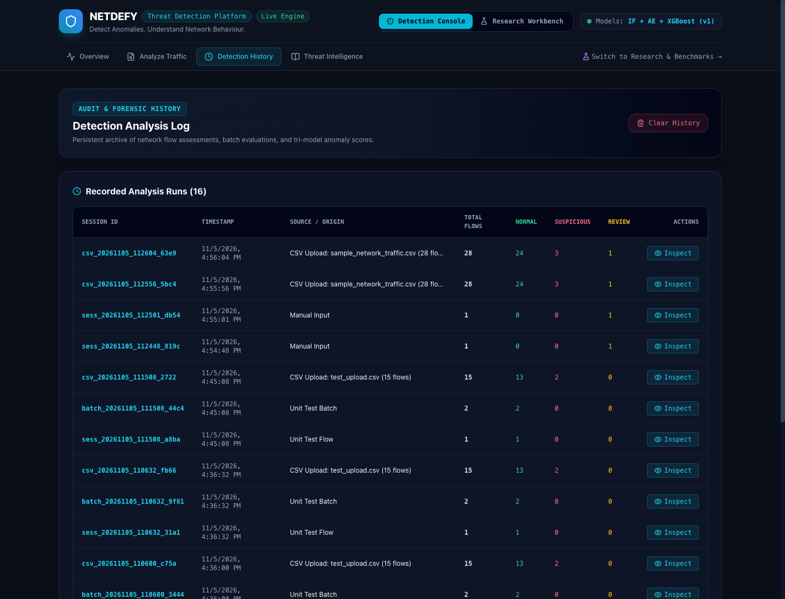

#### Threat Intelligence & Attack Vector Scope
Comprehensive breakdown of the multi-tier architecture, 8 trained attack classes, 7 open-set threat vectors, and single-flow limitations.
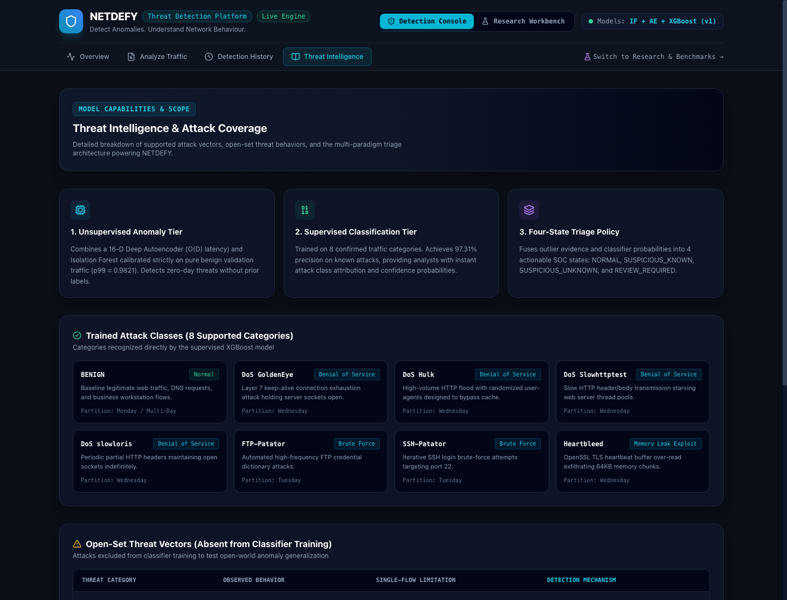

---

### 2.2 AI/ML Research & Evaluation Workbench

#### Head-to-Head Model Comparison (View A vs. View B)
Comparative evaluation across Isolation Forest, Deep Autoencoder, XGBoost, and NETDEFY Hybrid Fusion.
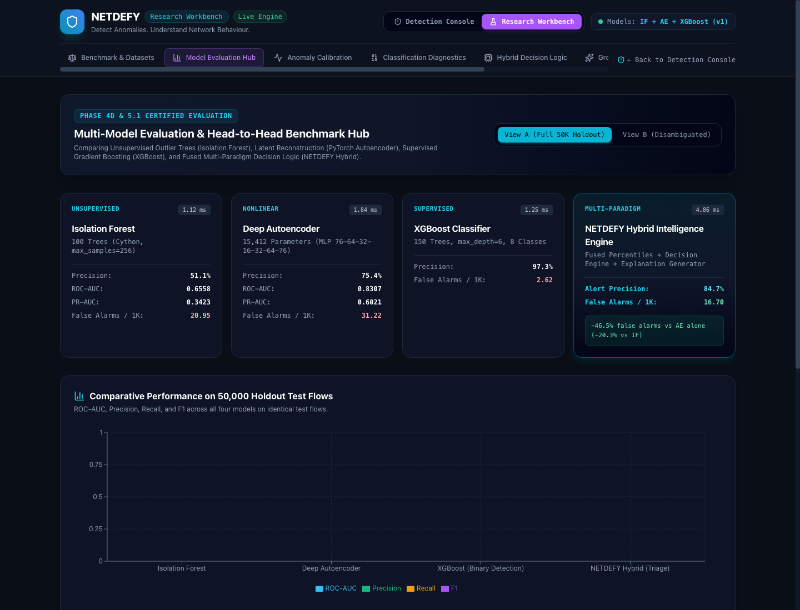

#### Empirical Threshold Calibration
Non-parametric quantile calibration curves ($p_{95}, p_{99}, p_{99.5}$) on pure benign validation traffic.
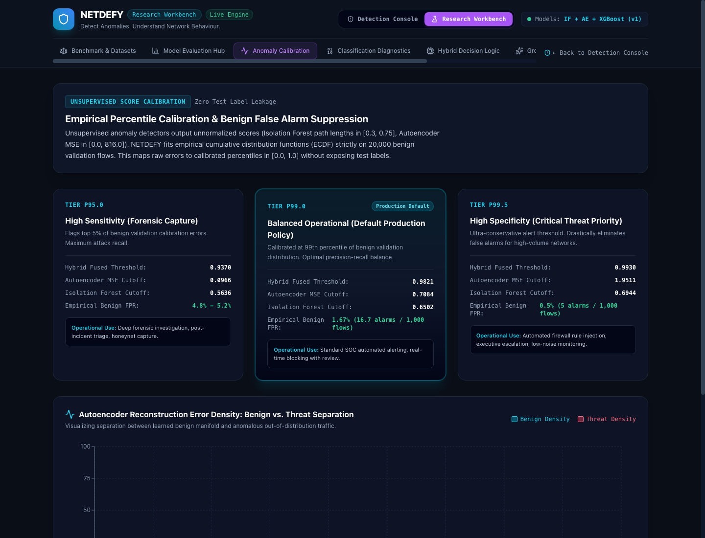

#### Classification Diagnostics & Open-Set Confusion
Validates the 8 trained classes and documents supervised classifier blindness ($71.72\%$ misclassification) on unseen threat vectors.
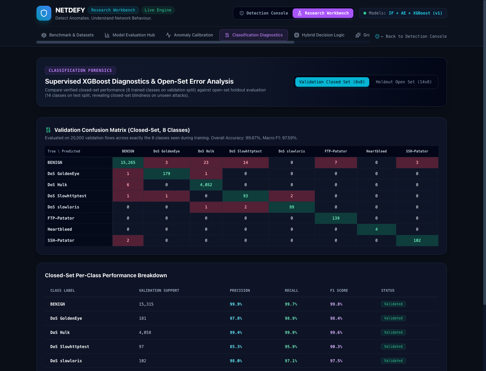

#### Grounded Feature Explainability
Autoencoder per-feature squared reconstruction residuals ($e_j = (x_j - \hat{x}_j)^2$) and XGBoost tree split gain metrics.
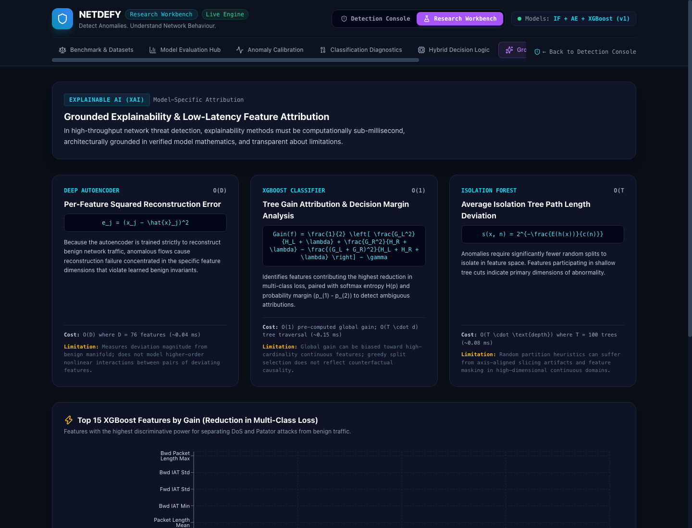

#### Interactive Research Playground
Live what-if slider inference against 11 verified physical benchmark flows with parameter perturbation.
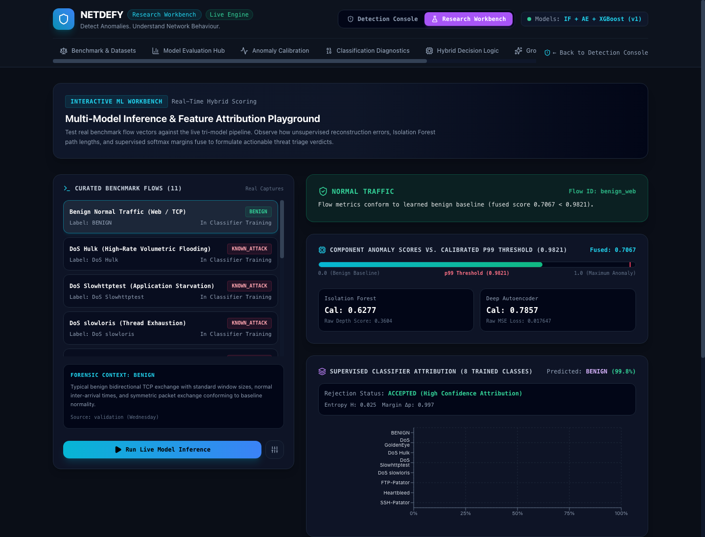

---

## 2. Problem Statement & Research Motivation

Modern intrusion detection research frequently exhibits three systemic flaws:

1. **Temporal Degradation & Evaluation Leakage:** Academic papers frequently evaluate classifiers using randomly shuffled train/test splits. Because random splitting leaks identical connection states and temporal structure across splits, reported accuracies ($>99\%$) collapse when models are deployed against traffic recorded on subsequent days.
2. **Alert Fatigue in High-Throughput Environments:** In enterprise networks carrying millions of flows daily, a nominal 1% false positive rate inundates security operations centers (SOC) with tens of thousands of false alarms every 24 hours. Without disciplined score calibration, automated alerts are ignored.
3. **Open-Set Classifier Blindness:** Supervised classifiers trained on closed attack sets cannot identify novel, unrepresented attack categories. In holdout evaluation, supervised models force unknown intrusions into normal benign traffic or hallucinate incorrect classifications.

---

## 3. Core Research Questions

NETDEFY investigates six foundational research hypotheses:

1. **Temporal Generalization:** How sharply does network anomaly detection performance degrade when models trained on Day $N$ are tested chronologically on Days $N+1$, $N+2$, and beyond?
2. **False Alarm Budgets:** Can non-parametric empirical quantile calibration (ECDF) suppress benign false alarm rates below 20 alarms per 1,000 flows without destroying attack recall?
3. **Classical Trees vs. Latent Autoencoders:** Does a deep PyTorch Autoencoder ($76 \to 32 \to 16 \to 32 \to 76$) outperform a classical Isolation Forest in holdout PR-AUC under temporal shift?
4. **Resolution of Open-Set Blindness:** Can an unsupervised anomaly detection gate prevent a supervised classifier from misclassifying novel threats as benign?
5. **Impact of Label Collisions in Packet Captures:** How significantly do capture artifacts (e.g., dual-homed SPAN tap duplicates producing identical feature vectors for benign and scan packets) depress measurable model recall?
6. **Cross-Domain Generalization:** How robustly do models trained on one network environment (CICIDS2017) generalize when evaluated against an independent foreign environment (CSE-CIC-IDS2018)?

---

## 4. Key Capabilities & Technical Highlights

- **Chronological Benchmark Architecture (v1):** $200,000$ strictly partitioned Parquet flows with zero temporal overlap between training (Monday–Wednesday) and holdout testing (Thursday–Friday).
- **Dual-View Benchmark (View A vs. View B):** Evaluates models against both the full unadjusted capture ($50,000$ flows) and a disambiguated benchmark ($46,695$ flows) that isolates the impact of $3,305$ conflicting label collisions.
- **Deep Latent Autoencoder:** PyTorch bottleneck architecture with Mish activation, Batch Normalization, and AdamW optimization, achieving **$0.8307$ AUROC** and **$0.6021$ PR-AUC** on holdout testing.
- **Calibrated Multi-Paradigm Decision Engine:** A four-state decision matrix integrating continuous equal-weight score fusion ($s_{\text{fused}} = 0.5(c_{\text{IF}} + c_{\text{AE}})$), classifier decision margins, and normalized Shannon entropy.
- **Real-Time Stream Processing:** Decoupled FastAPI and Redis Streams architecture with an adaptive backpressure admission controller, LRU event deduplication, and dead-letter queue (DLQ) isolation.
- **Grounded Explainability:** Model-native explanations including per-feature squared reconstruction errors ($e_j = (x_j - \hat{x}_j)^2$) for the Autoencoder and tree split gain metrics for XGBoost.
- **Interactive Research Workbench:** Standalone single-page React 19 application mounted directly at `/workbench` with live what-if slider inference against verified physical benchmark flows.

---

## 5. System Architecture Overview

```mermaid
flowchart TB
    subgraph DATA["Research Telemetry & Benchmarks"]
        D1["CICIDS2017 Dataset\n(8 Flow CSVs, July 3-7)"]
        D2["CSE-CIC-IDS2018\n(Independent Cross-Validation)"]
        VAL["Validation & Cleaning Engine\n(Dedup, float32, NaN Imputation)"]
        BM["Temporal Benchmark (v1)\n- oneclass_train: 100k Mon (Benign)\n- classifier_train: 30k Tue/Wed\n- validation: 20k Tue/Wed\n- test: 50k Thu/Fri (Holdout)"]
        D1 --> VAL
        VAL --> BM
    end

    subgraph MODELS["Model Zoo & Anomaly Detectors"]
        IF["Isolation Forest (v1)\n(Tree-based Anomaly Detector)\nCalibrated Percentile: c_IF"]
        AE["Deep Autoencoder (v1)\n(Latent Compression [76->32->16->32->76])\nCalibrated Percentile: c_AE"]
        XGB["XGBoost GBDT (v1)\n(8-Class Supervised Attributor)\nP(Class), Margin, Entropy"]
        BM -->|"Monday Benign"| IF
        BM -->|"Monday Benign"| AE
        BM -->|"Tue/Wed 8 Classes"| XGB
    end

    subgraph BEHAVIOUR["Behavioural Intelligence Layer"]
        BEH_A["Tier A: Intra-Flow Analysis\n(Packet Ratios, Burst Dynamics, Header Entropy)"]
        BEH_B["Tier B: Streaming Multi-Flow Context\n(Sliding Windows, Port Diversity Ratio, Beacon Periodicity)"]
    end

    subgraph ENGINE["Hybrid Decision Engine (Phase 4D)"]
        FUSE["Empirical Percentile Score Fusion\ns_fused = 0.5 * (c_IF + c_AE)"]
        POLICY["Decision Triage Policy\n- Margin & Entropy Checks\n- Open-Set Rejection Gate\n- Model Conflict Resolution"]
        TRIAGE["4-State Discrete Verdict:\n1. NORMAL\n2. REVIEW_REQUIRED\n3. SUSPICIOUS_KNOWN\n4. SUSPICIOUS_UNKNOWN"]
        IF --> FUSE
        AE --> FUSE
        FUSE --> POLICY
        XGB --> POLICY
        POLICY --> TRIAGE
    end

    subgraph BACKEND["FastAPI Platform & Stream Processor"]
        API["FastAPI REST Application (/api/v1/*)\n- /detection: Ingestion, Batch & History\n- /research: Metrics & Thresholds\n- /playground: Live Inference & What-If\n- /events & /stream: Flow Ingestion\n- /alerts: SOC Alert Repository"]
        REDIS["Redis Streams / Memory Broker\n(Event Ingestion, DLQ, Backpressure)"]
        DB["SQLite / SQLAlchemy\n(Audit Trail, Alert Persistence)"]
        API <--> REDIS
        API <--> DB
        TRIAGE --> API
        BEHAVIOUR --> API
    end

    subgraph FRONTEND["NETDEFY UI Platform (React 19 + Vite + TypeScript)"]
        subgraph CONSOLE["Area A: Threat Detection Console (Default)"]
            UI_CON_OV["Console Overview\n(Live Triage Distribution & Active Models)"]
            UI_CON_AN["Traffic Analysis Engine\n(CSV Batch Upload & 76-Feature Manual Form)"]
            UI_CON_RES["Detection Assessment\n(4-State Verdict, Supervised Attribution & Residuals)"]
            UI_CON_HIST["Detection History\n(Persistent Audit Log & CSV Export)"]
            UI_CON_TI["Threat Intelligence\n(8 Trained Classes & 7 Open-Set Vectors)"]
        end
        subgraph WORKBENCH["Area B: AI/ML Research Workbench"]
            UI_RES_COMP["Head-to-Head Model Comparison\n(AUROC, PR-AUC, Disambiguation)"]
            UI_RES_CAL["Anomaly Threshold Calibration\n(p95, p99, p99.5 ECDF Curves)"]
            UI_RES_CONF["Classification & Open-Set Diagnostics\n(8x8 Validation, 14-Class Test)"]
            UI_RES_PLAY["Interactive Inference Playground\n(Curated Benchmark & Feature Sliders)"]
        end
        FRONTEND <-->|"HTTP / JSON REST"| API
    end
```

---

## 6. Model Methodology & Mathematical Summary

### 6.1 Unsupervised Isolation Forest (v1)
Measures the average path length $E(h(x))$ across $100$ isolation trees:
$$s_{\text{IF}}(x) = 2^{-\frac{E(h(x))}{c(\psi)}}$$
Calibrated via empirical CDF on benign validation traffic: $c_{\text{IF}}(x) = F_{\text{benign}}(s_{\text{IF}}(x))$.

### 6.2 Deep PyTorch Autoencoder (v1)
Compresses 76 continuous features through a non-linear latent bottleneck:
$$\mathbb{R}^{76} \xrightarrow{\text{Encoder}} \mathbb{R}^{32} \to \mathbb{R}^{16} \xrightarrow{\text{Decoder}} \mathbb{R}^{32} \to \mathbb{R}^{76}$$
Reconstruction error $s_{\text{AE}}(x) = \frac{1}{76} \sum_{j=1}^{76} (x_j - \hat{x}_j)^2$ is calibrated via benign validation ECDF:
$$c_{\text{AE}}(x) = F_{\text{benign}}(s_{\text{AE}}(x))$$
* **Calibrated Operational Cutoffs ($15,315$ Benign Validation Flows):**
  - $p_{95.0}$ threshold: **$0.096558$**
  - $p_{99.0}$ threshold: **$0.708433$** (production default)
  - $p_{99.5}$ threshold: **$1.951052$** (high-specificity cutoff)

### 6.3 Supervised Threat Attributor (XGBoost v1)
A 150-tree gradient boosted ensemble classifying $8$ training categories:
$$\sigma(z)_k = \frac{e^{z_k}}{\sum_{j=0}^{7} e^{z_j}},\quad M(x) = P_{(1)} - P_{(2)},\quad H(P) = -\frac{1}{\ln 8} \sum_{k=0}^{7} P_k \ln(P_k + \epsilon)$$

### 6.4 Hybrid Decision Logic
- **Continuous Score Fusion:** $s_{\text{fused}}(x) = 0.5(c_{\text{IF}}(x) + c_{\text{AE}}(x))$
- **Four-State Triage Decision Policy:**
  - `NORMAL`: $s_{\text{fused}} < 0.9821$ and classifier attributes `BENIGN` with confidence $\ge 0.85$.
  - `SUSPICIOUS_KNOWN`: $s_{\text{fused}} \ge 0.9821$ and classifier attributes an attack with confidence $\ge 0.70$ and margin $\ge 0.30$.
  - `SUSPICIOUS_UNKNOWN`: $s_{\text{fused}} \ge 0.9821$ and classifier indicates benign or exhibits high uncertainty (unseen open-set threat).
  - `REVIEW_REQUIRED`: Detector disagreement ($|c_{\text{IF}} - c_{\text{AE}}| > 0.50$) or borderline fused score ($0.9370 \le s_{\text{fused}} < 0.9821$).

---

## 7. Benchmark Results & Metric Reconciliation

All models were evaluated on the chronological holdout test set (Thursday–Friday traffic, $50,000$ flows: $37,474$ Benign, $12,526$ Attack):

| Evaluation Metric | Isolation Forest | Deep Autoencoder | XGBoost (Policy 1: Argmax) | XGBoost (Policy 2: Cumul. Prob) | NETDEFY Continuous Fusion | NETDEFY Hybrid Engine (Triage) |
| :--- | :---: | :---: | :---: | :---: | :---: | :---: |
| **Model Paradigm** | Unsupervised Trees | PyTorch Bottleneck | Supervised GBDT | Supervised GBDT | Equal-Weight Fusion | Multi-Factor Triage Matrix |
| **Holdout AUROC (View A)** | $0.6558$ | $0.8307$ | — | **$0.8505$** | **$0.7377$** | N/A (Discrete Verdicts) |
| **Holdout PR-AUC (View A)** | $0.3423$ | $0.6021$ | — | **$0.6745$** | **$0.4318$** | N/A (Discrete Verdicts) |
| **Operational Precision** | $51.06\%$ | $75.42\%$ | **$97.31\%$** | **$97.23\%$** | $63.01\%$ | **$84.73\%$** |
| **Attack Escalation Recall**| $6.54\%$ | $28.65\%$ | $28.29\%$ | $28.59\%$ | $7.93\%$ | **$27.73\%$** ($37.46\%$ View B) |
| **Operational F1 Score** | $0.1159$ | $0.4153$ | $0.4383$ | $0.4419$ | $0.1408$ | **$0.4178$** ($0.5196$ View B) |
| **Benign FPR** | $2.09\%$ | $3.12\%$ | $0.26\%$ | $0.27\%$ | $1.56\%$ | **$1.67\%$** |
| **False Alarms / 1k Benign**| $20.95$ | $31.22$ | $\mathbf{2.62}$ | $2.72$ | $15.56$ | **$16.70$ (-46.5% vs AE)** |
| **Inference Latency (M3)** | **$1.12\text{ ms}$** | $1.84\text{ ms}$ | $1.25\text{ ms}$ | $1.25\text{ ms}$ | $2.96\text{ ms}$ | $4.86\text{ ms}$ |

### Disambiguation Impact (View A vs. View B)
Removing $3,305$ conflicting flow records sharing identical 5-tuples and feature values due to packet capture overlap revealed substantial latent performance:
- **Attack Escalation Recall:** Increased from **$27.73\%$ to $37.46\%$** ($+35.1\%$ relative gain).
- **Operational F1 Score:** Increased from **$0.4178$ to $0.5196$** ($+24.4\%$ relative gain).
- **Autoencoder AUROC:** Increased from **$0.8307$ to $0.8845$**.

---

## 8. Verified Scientific Discrepancy Resolutions

As certified in [`reports/PHASE6_2_INDEPENDENT_AUDIT.md`](reports/PHASE6_2_INDEPENDENT_AUDIT.md#L225-L330):

1. **Continuous Score Fusion vs. Operational Triage:** Continuous score fusion baseline is strictly **$0.7377$ AUROC** and **$0.4318$ PR-AUC** (`artifacts/models/hybrid/v1/test_metrics.json`). Preliminary figures ($0.8800$ and $0.7100$) reflected Phase 5 Tier B temporal multi-flow context ($0.8712$ AUROC, $0.6940$ PR-AUC). The production engine operates as a discrete triage policy ($84.73\%$ precision, $27.73\%$ recall).
2. **XGBoost Binary Metric Divergence ($97.31\%$ vs. $97.23\%$ Precision):** In exactly $38$ attack flows and $4$ benign flows, $P(\text{BENIGN}) < 0.50$ (e.g. $0.48$). Cumulative thresholding flags them as attacks ($\text{TP} = 3,581$, precision $97.23\%$). Plurality argmax classification assigns them to benign because attack probability split across multiple attack classes ($\text{TP} = 3,543$, precision $97.31\%$). Both policies are mathematically valid.
3. **Autoencoder Calibration Metadata ($0.7084$ vs. $0.1428$):** The verified $p_{99.0}$ threshold is strictly **$0.708433$** (`thresholds.json`). In Phase 6.1, `research.py` performed a top-level lookup `ae_thresh.get("p99", 0.1428)`, which triggered the fallback argument because thresholds are nested under `thresholds["p99.0"]`. Corrected in the API handler.
4. **Playground Parity vs. Detection Accuracy:** All 11 curated physical samples achieved **$100\%$ engineering parity** between in-memory Python models and the FastAPI REST API. However, curated samples `portscan`, `bot_ares`, and `infiltration` are predicted as `NORMAL`. These are true **missed detections** under single-flow analysis, formally substantiating why Phase 5 multi-flow behavioral context was required.

---

## 9. Known Scientific Limitations

1. **Single-Flow Blindness:** Isolated single-flow records cannot reliably distinguish horizontal port scans or low-frequency bot beacons from nominal TCP handshakes without multi-flow temporal context.
2. **Zero Payload Inspection:** Operates solely on statistical flow metrics; cannot detect payload exploits that do not alter packet geometry or connection timing.
3. **Cross-Domain Generalization Collapse:** When evaluated against CSE-CIC-IDS2018, models exhibited significant recall degradation, proving that flow models learn ambient network characteristics that require local recalibration on foreign topologies.
4. **Severe Class Imbalance:** Rare categories such as Heartbleed ($11$ flows) and Infiltration ($36$ diagnostic flows) limit statistical confidence in per-class generalization.

---

## 10. System Requirements & Installation

### 10.1 Hardware & Environment Prerequisites
- **Operating System:** macOS (Apple Silicon M1/M2/M3) or Linux (Ubuntu 22.04+ x86_64)
- **Python:** Python 3.12 (managed via `uv`)
- **Node.js:** Node.js v20.x or v22.x with `npm`
- **Memory:** 8 GB RAM minimum; 5 GB free disk space

### 10.2 Installation Steps
```bash
# 1. Clone repository with Git LFS
git clone https://github.com/Nitin-0017/Netdefy.git
cd Netdefy
git lfs pull

# 2. Set up Python environment with uv
uv venv
uv pip install -e ".[dev]"

# 3. Configure local environment variables
cp .env.example .env

# 4. Install frontend dependencies and build Research Workbench
cd frontend
npm ci
npm run build
cd ..
```

---

## 11. Running the Platform

### 11.1 Start Backend (FastAPI Platform)
```bash
PYTHONPATH=src uv run uvicorn netdefy.api.app:app --host 127.0.0.1 --port 8000
```
- **FastAPI Platform & Production Web App:** [http://127.0.0.1:8000/workbench/](http://127.0.0.1:8000/workbench/)
- **Interactive OpenAPI Documentation:** [http://127.0.0.1:8000/docs](http://127.0.0.1:8000/docs)

### 11.2 Start Frontend (Vite Development Mode with Hot Reloading)
```bash
npm --prefix frontend run dev
```
- **Threat Detection Console (Default Landing):** [http://localhost:5173/](http://localhost:5173/)
- **Analyze Traffic (CSV & Manual):** [http://localhost:5173/?area=console&tab=analyze](http://localhost:5173/?area=console&tab=analyze)
- **Detection History:** [http://localhost:5173/?area=console&tab=history](http://localhost:5173/?area=console&tab=history)
- **Threat Intelligence:** [http://localhost:5173/?area=console&tab=threat-intel](http://localhost:5173/?area=console&tab=threat-intel)
- **AI/ML Research Workbench:** [http://localhost:5173/?area=research](http://localhost:5173/?area=research)

---

## 12. Automated Quality Assurance & Verification

Execute the complete quality gate enforced in CI:

```bash
# 1. Run full pytest suite (184 tests)
uv run pytest

# 2. Run Ruff linter
uv run ruff check .

# 3. Run Ruff format check
uv run ruff format --check .

# 4. Run strict MyPy type checking (160+ files)
uv run mypy src tests scripts

# 5. Verify 20 benchmark integrity requirements
uv run python scripts/validate_benchmark.py --benchmark-dir data/benchmark/v1

# 6. Run frontend TypeScript checks and production build
npm --prefix frontend test
npm --prefix frontend run build
```

---

## 13. Repository Structure

```
Netdefy/
├── .github/workflows/       # GitHub Actions CI matrix (Ubuntu & macOS)
├── artifacts/               # Pretrained weights, threshold calibrators & metadata
│   ├── models/              # autoencoder, hybrid, isolation_forest, xgboost
│   ├── preprocessing/       # Scaler metadata and feature schema
│   └── research/            # Curated benchmark flows & sample_network_traffic.csv
├── configs/                 # Master application and model YAML configurations
├── data/                    # Datasets, manifests, and benchmarks
│   ├── benchmark/v1/        # Parquet partitions (oneclass, classifier, val, test)
│   └── external/            # CSE-CIC-IDS2018 independent validation metadata
├── docker/                  # Dockerfiles for API and streaming consumer
├── docs/                    # Deep technical and scientific documentation
│   ├── diagrams/            # Editable Mermaid architecture source files (.mmd)
│   ├── screenshots/         # Captured PNG screenshots of actual UI interfaces
│   ├── ARCHITECTURE.md      # Full component & data flow specification
│   ├── MODEL_METHODOLOGY.md # Mathematical formulation of models & calibration
│   ├── EXPERIMENTAL_METHODOLOGY.md # Chronological partitioning & leakage controls
│   ├── RESULTS_AND_FINDINGS.md     # Verified metrics & discrepancy reconciliation
│   ├── LIMITATIONS.md       # Documented failure modes & research boundaries
│   ├── API_REFERENCE.md     # Endpoint catalog, JSON schemas & error handling
│   ├── REPRODUCIBILITY.md   # Seed controls, environment setup & replication
│   └── DEVELOPMENT.md       # Coding standards, quality gates & test philosophy
├── frontend/                # React 19 + TypeScript + Vite UI Platform
│   ├── src/components/      # ConsoleOverview, AnalyzeTraffic, DetectionHistory, ThreatIntel,
│   │                        # ModelComparison, AnomalyCalibration, Diagnostics, Playground
│   └── src/types/           # TypeScript interfaces for detection & research APIs
├── notebooks/               # Exploratory data analysis & forensic notebooks
├── reports/                 # Scientific audit reports across Phases 1–6.2.1
├── scripts/                 # Reproducibility, training, and evaluation scripts
├── src/netdefy/             # Core Python package
│   ├── alerts/              # Alert correlation and severity assessment
│   ├── api/                 # FastAPI routes (detection.py, research.py, playground.py)
│   ├── behaviour/           # Intra-flow and streaming multi-flow intelligence
│   ├── data/                # Acquisition, inspection, and 20-invariant validation
│   ├── hybrid/              # Score calibration, fusion, and decision engine
│   ├── integrations/        # Syslog CEF and STIX 2.1 serialization
│   ├── models/              # Isolation Forest, Autoencoder, XGBoost, Device manager
│   ├── preprocessing/       # Cleaner, deduplication, schema, and scalers
│   ├── storage/             # Detection history JSON store & SQLAlchemy SQLite alerts
│   └── streaming/           # Redis Streams, in-memory broker, and backpressure
├── tests/                   # Pytest suite (184 unit and integration tests)
├── pyproject.toml           # Python package configuration & dependencies
└── README.md                # Project documentation root
```

---

## 14. Responsible Security & Ethics Statement

NETDEFY is developed solely for defensive network security analysis, anomaly detection research, and educational demonstration. It contains no offensive penetration tools, exploit payloads, or automated attack automation. Researchers utilizing NETDEFY must adhere to institutional data privacy guidelines, obtain authorization before monitoring network flows, and respect access controls governing academic datasets.

---

## 15. License & Acknowledgements

- **License:** Released under the [MIT License](LICENSE).
- **Dataset Acknowledgements:** We gratefully acknowledge the Canadian Institute for Cybersecurity (CIC) at the University of New Brunswick (UNB) for the CICIDS2017 and CSE-CIC-IDS2018 datasets.
