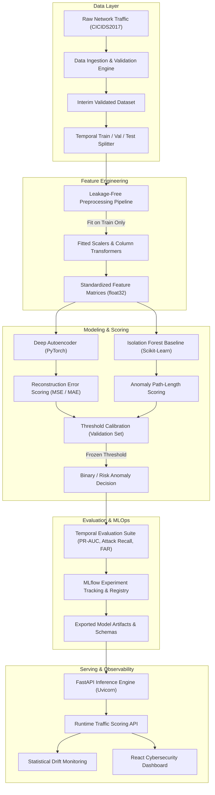

# NETDEFY System Architecture

**Network Defense Intelligence (NETDEFY)** is an AI-powered defensive network anomaly detection platform engineered to investigate temporal generalization, operational latency, and statistical behavior in network traffic.

---

## 1. End-to-End System Pipeline

---

## 2. Architectural Components

### 2.1 Data Validation Engine (`src/netdefy/data/`)
- **Status:** **Implemented in Phase 1.**
- Validates structural and numerical integrity of incoming network flow records.
- Checks:
  - Missing mandatory schema columns.
  - Zero-row or truncated datasets.
  - Duplicate flow rows.
  - Presence of missing (`NaN`, `None`, empty string) values.
  - Infinite (`+inf`, `-inf`) numerical values caused by flow duration division.
  - Invalid numerical data types.
  - Column schema consistency across partitioned days.

### 2.2 Leakage-Free Preprocessing Engine (`src/netdefy/preprocessing/`)
- **Status:** *Planned for Phase 2.*
- Enforces strict data-hygiene boundaries:
  - Scalers (`StandardScaler`, `RobustScaler`) fit strictly on training partitions; validation and test splits are strictly transformed.
  - Drops operational identifiers that cause shortcut learning: `Source IP`, `Destination IP`, `Timestamp`, `Flow ID`, `Source Port`.
  - Imputes numerical anomalies using training set medians.
  - Casts features to `float32` to guarantee memory efficiency on Apple Silicon unified memory (8 GB M3).

### 2.3 Model Architecture & Acceleration (`src/netdefy/models/`)
- **Status:** **Device Management Implemented in Phase 1; Model Training Planned for Phase 2.**
- **Device Management (`device.py`):**
  - Auto-detects Apple Silicon Metal Performance Shaders (`mps`), NVIDIA CUDA (`cuda`), or fallback `cpu`.
  - Executes active tensor verification before device assignment.
- **Deep Autoencoder (PyTorch):**
  - Symmetric multi-layer encoder-decoder architecture with bottleneck compression.
  - Trained exclusively on benign network traffic to learn normal baseline behavior.
  - Anomaly metric: Reconstruction error $\mathcal{L}(x, \hat{x}) = \|x - \hat{x}\|_2^2$.
- **Isolation Forest Baseline (Scikit-learn):**
  - Tree-based isolation ensemble to benchmark classical machine learning against deep learning.

### 2.4 Anomaly Scoring & Threshold Calibration (`src/netdefy/evaluation/`)
- **Status:** *Planned for Phase 2/3.*
- Uses the temporal validation set to select a decision boundary (e.g., 99th percentile of benign validation reconstruction errors).
- Freezes threshold prior to evaluating on unseen future temporal test sets.

### 2.5 Experiment Tracking & Governance (`mlruns/`)
- **Status:** **Configuration & Schema Implemented in Phase 1; Tracking Planned for Phase 2.**
- MLflow logs:
  - Dataset source checksums and temporal split boundaries.
  - Preprocessing parameters and feature list schemas.
  - Model hyper-parameters, optimizer configs, random seeds.
  - Multi-metric evaluation (PR-AUC, ROC-AUC, Attack-wise recall, False alarm rate per 1,000 flows).
  - Profiling metrics: CPU/MPS peak memory usage and latency per 1,000 inferences.

### 2.6 FastAPI Inference Service (`src/netdefy/inference/`)
- **Status:** *Planned for Phase 3.*
- High-throughput asynchronous REST API for single-flow and batch anomaly scoring.
- Validates input payloads against Pydantic flow schemas before scoring.
- Returns binary prediction (`ANOMALY` vs `BENIGN`), reconstruction error, and calibrated confidence score.

### 2.7 Observability & Drift Monitoring (`src/netdefy/monitoring/`)
- **Status:** *Planned for Phase 4.*
- Monitors feature distributions and reconstruction error drift over time.
- Triggers alert flags when feature drift (Kolmogorov-Smirnov / Wasserstein distance) surpasses warning thresholds.

### 2.8 Cyber Defense Analytics Dashboard
- **Status:** *Planned for Phase 4.*
- React 18, TypeScript, Vite, TailwindCSS, and Recharts.
- Visualizes:
  - Real-time flow telemetry and anomaly timeline.
  - Attack category distribution.
  - Feature attribution / reconstruction error heatmaps.
  - Operational hardware metrics (throughput, latency, memory).

---

## 3. Engineering Constraints & Resource Awareness
- **Target Hardware:** Apple M3 with 8 GB Unified Memory.
- **Memory Preservation:**
  - Chunk-based CSV loading (e.g., 50,000 rows/chunk).
  - Explicit garbage collection and `torch.mps.empty_cache()` hooks.
  - Single-precision (`float32`) tensors to halve memory footprints compared to standard 64-bit doubles.

