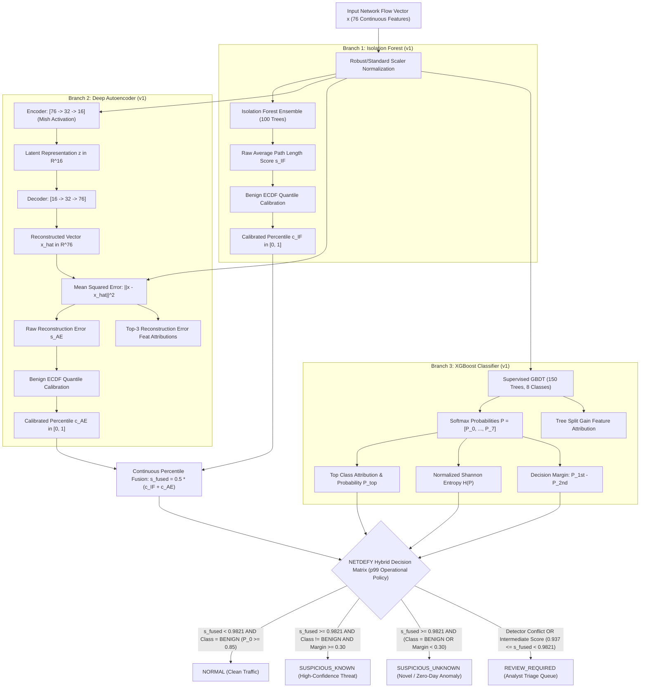
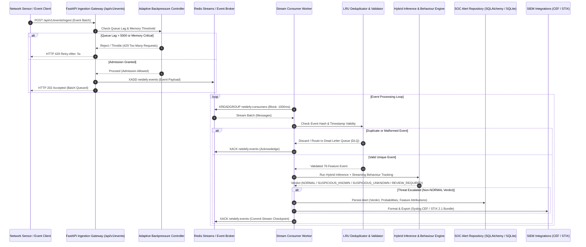
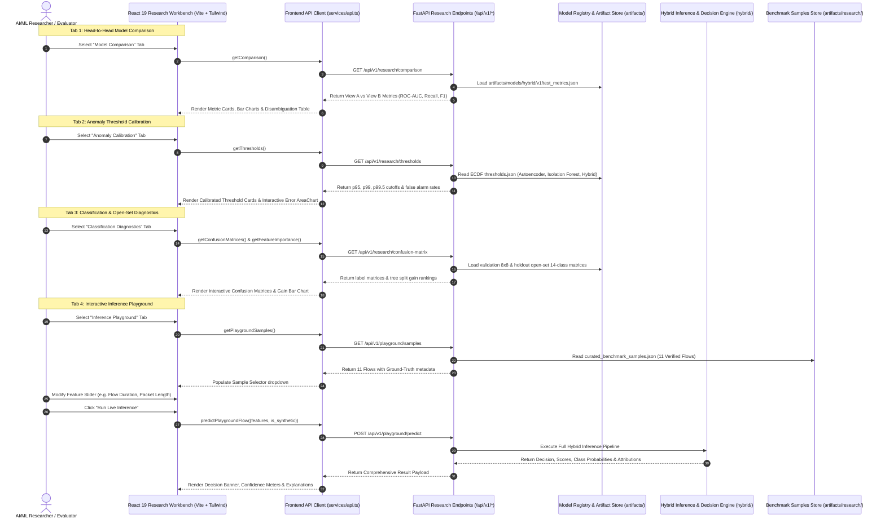

# NETDEFY — System Architecture & Component Design

> **Document Type:** Technical Architecture Specification  
> **Target Audience:** Systems Engineers, AI/ML Engineers, Technical Reviewers  
> **Source Directory:** `src/netdefy/`  
> **Frontend Directory:** `frontend/`  

---

## 1. High-Level Architectural Overview

NETDEFY is structured as a modular, decoupled cybersecurity platform that unifies offline batch machine learning research with real-time stream ingestion and interactive visualization.

```mermaid
flowchart TB
    subgraph DATA["Research Telemetry & Benchmarks"]
        D1["CICIDS2017 Dataset\n(8 Flow CSVs, July 3-7)"]
        D2["CSE-CIC-IDS2018\n(Independent Cross-Validation)"]
        VAL["Validation & Cleaning Engine\n(Dedup, float32, NaN Imputation)"]
        BM["Temporal Benchmark (v1)\n- oneclass_train: 100k Mon (Benign)\n- classifier_train: 30k Tue/Wed\n- validation: 20k Tue/Wed\n- test: 50k Thu/Fri (Holdout)"]
        D1 --> VAL
        VAL --> BM
    end

    subgraph MODELS["Model Zoo & Anomaly Detectors"]
        IF["Isolation Forest (v1)\n(Tree-based Anomaly Detector)\nCalibrated Percentile: c_IF"]
        AE["Deep Autoencoder (v1)\n(Latent Compression [76->32->16->32->76])\nCalibrated Percentile: c_AE"]
        XGB["XGBoost GBDT (v1)\n(8-Class Supervised Attributor)\nP(Class), Margin, Entropy"]
        BM -->|"Monday Benign"| IF
        BM -->|"Monday Benign"| AE
        BM -->|"Tue/Wed 8 Classes"| XGB
    end

    subgraph BEHAVIOUR["Behavioural Intelligence Layer"]
        BEH_A["Tier A: Intra-Flow Analysis\n(Packet Ratios, Burst Dynamics, Header Entropy)"]
        BEH_B["Tier B: Streaming Multi-Flow Context\n(Sliding Windows, Port Diversity Ratio, Beacon Periodicity)"]
    end

    subgraph ENGINE["Hybrid Decision Engine (Phase 4D)"]
        FUSE["Empirical Percentile Score Fusion\ns_fused = 0.5 * (c_IF + c_AE)"]
        POLICY["Decision Triage Policy\n- Margin & Entropy Checks\n- Open-Set Rejection Gate\n- Model Conflict Resolution"]
        TRIAGE["4-State Discrete Verdict:\n1. NORMAL\n2. REVIEW_REQUIRED\n3. SUSPICIOUS_KNOWN\n4. SUSPICIOUS_UNKNOWN"]
        IF --> FUSE
        AE --> FUSE
        FUSE --> POLICY
        XGB --> POLICY
        POLICY --> TRIAGE
    end

    subgraph BACKEND["FastAPI Platform & Stream Processor"]
        API["FastAPI REST Application (/api/v1/*)\n- /research: Metrics & Thresholds\n- /playground: Live Inference & What-If\n- /events & /stream: Flow Ingestion\n- /alerts: SOC Alert Repository"]
        REDIS["Redis Streams / Memory Broker\n(Event Ingestion, DLQ, Backpressure)"]
        DB["SQLite / SQLAlchemy\n(Audit Trail, Alert Persistence)"]
        API <--> REDIS
        API <--> DB
        TRIAGE --> API
        BEHAVIOUR --> API
    end

    subgraph FRONTEND["AI/ML Research Workbench (React 19 + Vite + TS)"]
        UI_OV["Research Overview\n(Scientific Context & Architecture)"]
        UI_COMP["Head-to-Head Model Comparison\n(AUROC, PR-AUC, Disambiguation)"]
        UI_CAL["Anomaly Threshold Calibration\n(p95, p99, p99.5 ECDF Curves)"]
        UI_CONF["Classification & Open-Set Diagnostics\n(8x8 Validation, 14-Class Test)"]
        UI_PLAY["Interactive Inference Playground\n(Curated Benchmark & Feature Sliders)"]
        FRONTEND <-->|"HTTP / JSON REST"| API
    end
```

---

## 2. Core Subsystems & Module Breakdown

### 2.1 Data & Forensic Inspection Subsystem (`src/netdefy/data/`)
- **[`acquisition.py`](../src/netdefy/data/acquisition.py):** Implements safe extraction with Zip Slip path-traversal prevention, SHA-256 cryptographic verification, and manifest registration.
- **[`inspection.py`](../src/netdefy/data/inspection.py):** Performs deep telemetry auditing across raw flow CSVs, detecting rate infinities (`Flow Bytes/s`, `Flow Packets/s`), irregular whitespace, and bitwise row duplicates.
- **[`validation.py`](../src/netdefy/data/validation.py):** Verifies 20 strict benchmark invariants including partition disjointness, zero temporal leakage, float32 precision, and feature schema purity.
- **[`manifest.py`](../src/netdefy/data/manifest.py):** Generates reproducible dataset manifests with cryptographic hashes and row count tracking.

### 2.2 Preprocessing & Feature Engineering Subsystem (`src/netdefy/preprocessing/`)
- **[`cleaner.py`](../src/netdefy/preprocessing/cleaner.py):** Canonicalizes column headers, replaces `+inf`/`-inf` with `NaN`, and performs median imputation using parameters derived exclusively from training data.
- **[`deduplication.py`](../src/netdefy/preprocessing/deduplication.py):** Removes bitwise identical rows generated by dual-homed network taps while preserving legitimate duplicate connection events.
- **[`scaler.py`](../src/netdefy/preprocessing/scaler.py):** Fits `RobustScaler` (median & IQR) and `StandardScaler` on pure training partitions, enforcing zero test information leakage.
- **[`schema.py`](../src/netdefy/preprocessing/schema.py):** Maintains canonical 76-continuous-feature mapping and standardizes network port services.

### 2.3 Model Zoo & Acceleration Subsystem (`src/netdefy/models/`)
- **[`isolation_forest.py`](../src/netdefy/models/isolation_forest.py):** Unsupervised isolation tree ensemble (100 trees) detecting outliers via path length compression.
- **[`autoencoder.py`](../src/netdefy/models/autoencoder.py):** Fully-connected PyTorch bottleneck architecture ($76 \to 32 \to 16 \to 32 \to 76$) with Mish non-linear activation and Batch Normalization.
- **[`xgboost_classifier.py`](../src/netdefy/models/xgboost_classifier.py):** Multi-class gradient boosted trees (150 estimators, max depth 6) attributing known threats across 8 training classes.
- **[`device.py`](../src/netdefy/models/device.py):** Hardware accelerator manager auto-detecting Apple Silicon (MPS), NVIDIA (CUDA), or CPU with runtime tensor verification.

### 2.4 Hybrid Intelligence & Decision Engine (`src/netdefy/hybrid/`)
- **[`score_calibration.py`](../src/netdefy/hybrid/score_calibration.py):** Maps raw, unnormalized detector outputs ($s_{\text{IF}} \in [0.3, 0.75]$, $s_{\text{AE}} \in [0.0, 816.0]$) to calibrated empirical percentiles in $[0.0, 1.0]$ using ECDF estimation on $15,315$ benign validation flows.
- **[`score_fusion.py`](../src/netdefy/hybrid/score_fusion.py):** Computes equal-weight and weighted score fusions: $s_{\text{fused}} = 0.5(c_{\text{IF}} + c_{\text{AE}})$.
- **[`decision_engine.py`](../src/netdefy/hybrid/decision_engine.py):** Implements multi-factor triage logic incorporating supervised confidence, decision margins, normalized entropy, and detector disagreement thresholds.
- **[`explanation.py`](../src/netdefy/hybrid/explanation.py):** Produces model-native feature attributions (squared reconstruction residuals for Autoencoder, tree split gains for XGBoost).
- **[`model_registry.py`](../src/netdefy/hybrid/model_registry.py):** Manages concurrent loading, caching, and health verification for all model artifacts.

### 2.5 Behavioural Intelligence Layer (`src/netdefy/behaviour/`)
- **Tier A (Intra-Flow Behaviour):** Computes directional payload ratios, inter-arrival jitter, and TCP flag combinations from isolated flow metrics.
- **Tier B (Streaming Multi-Flow Context):** Memory-bounded sliding windows tracking destination port diversity (detecting stealthy horizontal port scans) and inter-connection periodicity (detecting low-frequency botnet beaconing).

### 2.6 Streaming Processor & SOC Engine (`src/netdefy/streaming/` & `src/netdefy/storage/`)
- **[`redis_streams.py`](../src/netdefy/streaming/redis_streams.py):** High-throughput event ingestion using Redis Consumer Groups with PEL acknowledgment and crash recovery.
- **[`in_memory_broker.py`](../src/netdefy/streaming/in_memory_broker.py):** Zero-dependency streaming broker used for local testing, CI, and lightweight standalone execution.
- **[`backpressure.py`](../src/netdefy/streaming/backpressure.py):** Dynamic admission controller evaluating stream depth and worker latency, rejecting input (`HTTP 429`) under saturation.
- **[`dead_letter_queue.py`](../src/netdefy/streaming/dead_letter_queue.py):** Automatically isolates poison pills and schema-invalid events after exponential backoff retries.
- **[`alert_repository.py`](../src/netdefy/storage/alert_repository.py):** Thread-safe SQLAlchemy persistence of alerts, verdicts, probabilities, and attributions to SQLite.

---

## 3. Model Inference Pipeline Flow



---

## 4. Real-Time Streaming Sequence



---

## 5. Research Workbench Interaction Architecture


