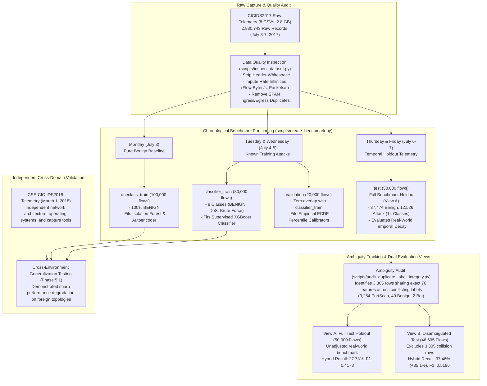

# NETDEFY — Experimental Methodology & Scientific Benchmarking

> **Document Type:** Scientific & Experimental Specification  
> **Benchmark Directory:** `data/benchmark/v1/`  
> **Verification Script:** `scripts/validate_benchmark.py`  
> **External Validation:** CSE-CIC-IDS2018  

---

## 1. Experimental Pipeline Overview

NETDEFY enforces strict data hygiene, zero-temporal-leakage partitioning, and empirical reproducibility across all experiments.

---

## 2. Benchmark Dataset Architecture (v1)

The primary benchmark (`data/benchmark/v1/`) comprises exactly **200,000 flows** formatted as Apache Parquet files with explicit data types and metadata manifests:

| Partition File | Sample Count | Source Days | Class Composition | Primary Experimental Role |
| :--- | :---: | :---: | :---: | :--- |
| **`oneclass_train.parquet`** | $100,000$ | Monday | 100% BENIGN | Unsupervised baseline training (IF & Autoencoder) |
| **`classifier_train.parquet`**| $30,000$ | Tuesday, Wednesday | 8 Training Classes | Supervised threat attribution training (XGBoost) |
| **`validation.parquet`** | $20,000$ | Tuesday, Wednesday | 8 Classes (Disjoint) | Threshold calibration & hyperparameter tuning |
| **`test.parquet`** | $50,000$ | Thursday, Friday | 14 Attack Classes | Holdout temporal evaluation (View A Benchmark) |
| **`rare_class_diagnostic.parquet`**| $6,193$ | All Days | Rare Attacks | Low-frequency class auditing (Heartbleed, Infiltration) |

---

## 3. Strict Scientific Leakage Controls

NETDEFY enforces six structural barriers against data contamination:

1. **Chronological Partitioning:** Training data originates strictly from Monday–Wednesday; test evaluation originates strictly from Thursday–Friday. No future packets can influence historical baselines.
2. **Disjoint Partitioning:** `classifier_train` and `validation` originate from the same capture days but maintain **0 overlapping flow records**.
3. **Scaler Quarantine:** Feature scaling statistics ($\mu, \sigma, \text{median}, \text{IQR}$) are computed solely from `oneclass_train` and `classifier_train`. Test flows are transformed using frozen scalers.
4. **Zero Test Threshold Calibration:** Quantile cutoffs ($p_{95}, p_{99}, p_{99.5}$) are calculated exclusively on the $15,315$ benign flows of `validation.parquet`. Test labels are never observed during calibration.
5. **Port Exclusion:** `Destination Port` is omitted from continuous feature matrices to eliminate static service memorization.
6. **20-Invariant Automated Verification:** Every benchmark partition is verified before model execution using [`scripts/validate_benchmark.py`](../scripts/validate_benchmark.py), ensuring $100\%$ schema consistency, float32 precision, and zero non-finite values.

---

## 4. Forensic Ambiguity & Dual Evaluation Views

During Phase 3 forensic auditing, an exact matching join across the 76 continuous features revealed that **$3,305$ flow records in the holdout test set share identical continuous feature representations across conflicting ground-truth labels**:
- $3,254$ records labeled `PortScan` identical to `BENIGN` flows.
- $49$ records labeled `BENIGN` identical to attack flows.
- $2$ records labeled `Bot` identical to `BENIGN` flows.

### Root Cause:
Packet capture taps placed simultaneously on switch monitor (SPAN) ports record single-packet TCP handshakes or failed connection resets without payload data. Because CICFlowMeter extracts identical statistical values for both benign SYN scans and malicious reconnaissance probes, single-flow feature representations become geometrically indistinguishable.

### Handling Strategy:
NETDEFY preserves both evaluation perspectives:
- **View A (Full Benchmark, $N = 50,000$):** Retains all $3,305$ collision rows. Measures operational performance under raw sensor imperfections.
- **View B (Disambiguated Benchmark, $N = 46,695$):** Excludes the $3,305$ collision rows documented in `ambiguity_manifest.json`. Isolates true model recall when packet capture artifacts are removed.

---

## 5. Independent Cross-Domain Validation (CSE-CIC-IDS2018)

To evaluate whether NETDEFY models learn generalized network attack concepts or merely memorize CICIDS2017 environment artifacts, an independent evaluation was executed against **CSE-CIC-IDS2018**:
- **Dataset:** CSE-CIC-IDS2018 (Thursday, March 1, 2018 recording session).
- **Environment:** AWS virtualized infrastructure, distinct IP subnets, operating systems, and network topologies.
- **Attack Types:** Infiltration and Botnet activity.
- **Key Finding:** While models maintained high precision on familiar attack signatures, anomaly detection recall on novel topologies degraded significantly. This empirically confirms that flow-based anomaly detection models suffer from domain shift when deployed in foreign network environments without local calibration.
