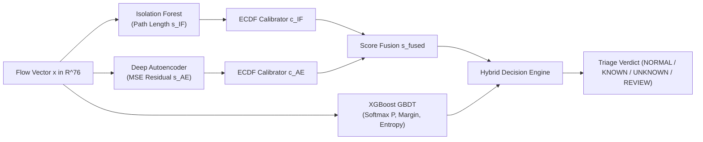

# NETDEFY — Model Methodology & Inference Formulation

> **Document Type:** Scientific & Mathematical Specification  
> **Source Modules:** `src/netdefy/models/`, `src/netdefy/hybrid/`, `src/netdefy/preprocessing/`  
> **Artifacts Path:** `artifacts/models/`  

---

## 1. Overview of the Model Ensemble

NETDEFY deploys a three-branch hybrid architecture designed to overcome the classical limitations of standalone anomaly detection and supervised classification:

1. **Isolation Forest (v1):** Fast, non-parametric tree-based anomaly detector measuring path-length isolation.
2. **Deep Autoencoder (v1):** Non-linear manifold compression learning geometric representations of benign network traffic.
3. **XGBoost Classifier (v1):** High-precision gradient boosted decision tree (GBDT) attributing known attacks across 8 classes.
4. **Hybrid Decision Engine (v1):** Combines calibrated anomaly percentiles and classifier signals into a four-state triage verdict.



---

## 2. Feature Schema & Preprocessing Formulation

### 2.1 The 76 Continuous Feature Vector
NETDEFY processes bidirectional network flows extracted via CICFlowMeter. From the raw telemetry, exactly **76 continuous features** are retained:
- **Flow Timing & Duration (6):** `Flow Duration`, `Flow IAT Mean`, `Flow IAT Std`, `Flow IAT Max`, `Flow IAT Min`, `Idle Mean`.
- **Packet Length Distribution (16):** `Total Fwd Packets`, `Total Backward Packets`, `Total Length of Fwd Packets`, `Total Length of Bwd Packets`, `Fwd Packet Length Max/Min/Mean/Std`, `Bwd Packet Length Max/Min/Mean/Std`.
- **Packet Rates (4):** `Flow Bytes/s`, `Flow Packets/s`, `Fwd Packets/s`, `Bwd Packets/s`.
- **Directional Inter-Arrival Times (8):** `Fwd IAT Total/Mean/Std/Max/Min`, `Bwd IAT Total/Mean/Std/Max/Min`.
- **TCP Control Flags & Windows (12):** `Fwd PSH Flags`, `Bwd PSH Flags`, `Fwd URG Flags`, `Bwd URG Flags`, `FIN/SYN/RST/PSH/ACK/URG/CWE/ECE Flag Count`, `Init_Win_bytes_forward`, `Init_Win_bytes_backward`.
- **Header Lengths & Active/Idle States (14):** `Fwd Header Length`, `Bwd Header Length`, `min_seg_size_forward`, `Active Mean/Std/Max/Min`, `Idle Std/Max/Min`.
- **Subflow Statistics (8):** `Subflow Fwd Packets`, `Subflow Fwd Bytes`, `Subflow Bwd Packets`, `Subflow Bwd Bytes`.
- **Packet Size Metrics (8):** `Min Packet Length`, `Max Packet Length`, `Packet Length Mean/Std/Variance`, `Down/Up Ratio`, `Average Packet Size`, `Avg Fwd/Bwd Segment Size`.

> [!IMPORTANT]
> **Port and Label Exclusion:** `Destination Port` is explicitly excluded from the 76-feature matrix to prevent models from memorizing static service ports (e.g., classifying port 21 as FTP-Patator). `Label` is strictly held as evaluation ground truth.

### 2.2 Normalization & Zero-Leakage Pipeline
Feature vectors are normalized using parameters fitted strictly on training partitions:
$$z_j = \frac{x_j - \text{median}(x_j)}{\text{IQR}(x_j)}$$
For deep learning, features are scaled via `StandardScaler` ($\mu = 0, \sigma = 1$). All missing values ($NaN$) and infinite rates resulting from zero flow durations are imputed with the median of the benign training set.

---

## 3. Anomaly Detection Models

### 3.1 Isolation Forest (v1)
* **Algorithm:** Ensemble of $100$ isolation trees, sub-sampling size $\psi = 256$, max features $1.0$.
* **Mathematical Anomaly Score:**
  Given an average path length $E(h(x))$ across all trees, the raw anomaly score $s_{\text{IF}}(x)$ is:
  $$s_{\text{IF}}(x) = 2^{-\frac{E(h(x))}{c(\psi)}}$$
  where $c(\psi)$ is the average path length of an unsuccessful search in a Binary Search Tree:
  $$c(\psi) = 2 \ln(\psi - 1) + 0.5772156649\ (\text{Euler's constant}) - \frac{2(\psi - 1)}{\psi}$$
* **Calibration:** The raw score $s_{\text{IF}} \in [0.3185, 0.7482]$ is transformed via empirical cumulative distribution function (ECDF):
  $$c_{\text{IF}}(x) = F_{\text{benign}}(s_{\text{IF}}(x)) = \frac{1}{N_{\text{val}}} \sum_{i=1}^{N_{\text{val}}} \mathbb{I}(s_{\text{IF}}^{(i)} \le s_{\text{IF}}(x))$$
  producing calibrated percentiles $c_{\text{IF}} \in [0.0, 1.0]$.

### 3.2 Deep Autoencoder (v1)
* **PyTorch Architecture:**
  - Input Layer: $\mathbb{R}^{76}$
  - Encoder Layer 1: $\text{Linear}(76 \to 32) \to \text{BatchNorm1d} \to \text{Mish}() \to \text{Dropout}(0.05)$
  - Bottleneck Latent Space: $\text{Linear}(32 \to 16) \to \text{BatchNorm1d} \to \text{Mish}()$ ($z \in \mathbb{R}^{16}$)
  - Decoder Layer 1: $\text{Linear}(16 \to 32) \to \text{BatchNorm1d} \to \text{Mish}() \to \text{Dropout}(0.05)$
  - Output Layer: $\text{Linear}(32 \to 76) \to \hat{x} \in \mathbb{R}^{76}$
* **Training Objective:**
  Optimized strictly on pure benign flows ($N = 100,000$, Monday) using Mean Squared Error (MSE):
  $$\mathcal{L}(x, \hat{x}) = \frac{1}{D} \sum_{j=1}^{D} (x_j - \hat{x}_j)^2$$
  Trained with AdamW ($lr = 10^{-3}$, weight decay $10^{-5}$), batch size $256$, and Cosine Annealing learning rate schedule.
* **Calibrated Reconstruction Score:**
  Reconstruction error $s_{\text{AE}}(x) = \text{MSE}(x, \hat{x})$ is mapped to an empirical percentile $c_{\text{AE}}(x) \in [0.0, 1.0]$ via benign validation ECDF:
  $$c_{\text{AE}}(x) = F_{\text{benign}}(s_{\text{AE}}(x))$$
* **Verified Percentile Cutoffs ($15,315$ Benign Validation Flows):**
  - $p_{95.0}$ threshold: **$0.096558$**
  - $p_{99.0}$ threshold: **$0.708433$** (balanced production cutoff)
  - $p_{99.5}$ threshold: **$1.951052$** (high-specificity cutoff)

---

## 4. Supervised Threat Attributor (XGBoost Classifier v1)

* **Architecture:** Extreme Gradient Boosting (XGBoost), $150$ estimators, max tree depth $6$, learning rate $\eta = 0.10$, multi-class log loss.
* **Training Classes ($8$ Classes, Tuesday–Wednesday):**
  ```
  0: BENIGN
  1: DoS GoldenEye
  2: DoS Hulk
  3: DoS Slowhttptest
  4: DoS slowloris
  5: FTP-Patator
  6: Heartbleed
  7: SSH-Patator
  ```
* **Classifier Uncertainty Metrics:**
  1. **Softmax Probabilities:** $P_k = \sigma(z)_k = \frac{e^{z_k}}{\sum_{j=0}^{7} e^{z_j}}$
  2. **Top Attributed Class:** $k_{\text{top}} = \text{argmax}_{k \in \{0..7\}} P_k$ with confidence $P_{\text{top}} = \max_k P_k$.
  3. **Decision Margin:** Difference between top-1 and top-2 probabilities:
     $$M(x) = P_{(1)} - P_{(2)}$$
  4. **Normalized Shannon Entropy:** Measures attribution dispersion across classes:
     $$H(P) = -\frac{1}{\ln(8)} \sum_{k=0}^{7} P_k \ln(P_k + \epsilon) \in [0.0, 1.0]$$

---

## 5. Multi-Paradigm Hybrid Decision Engine

### 5.1 Continuous Score Fusion
To combine tree-based and neural anomaly signals without scale distortions, NETDEFY computes the equal-weight mean of calibrated percentiles:
$$s_{\text{fused}}(x) = 0.5 \cdot \big(c_{\text{IF}}(x) + c_{\text{AE}}(x)\big)$$
* **Holdout AUROC:** **$0.7377$** ($0.737683$)
* **Holdout PR-AUC:** **$0.4318$** ($0.431844$)

### 5.2 Four-State Decision Matrix
The operational engine evaluates the following hierarchical triage rules:

```
IF |c_IF - c_AE| > 0.50:
    RETURN REVIEW_REQUIRED (Detector Conflict)

IF s_fused >= 0.9821 (p99 Cutoff):
    IF k_top != BENIGN AND P_top >= 0.70 AND M >= 0.30:
        RETURN SUSPICIOUS_KNOWN (High-Confidence Threat)
    ELSE:
        RETURN SUSPICIOUS_UNKNOWN (Open-Set / Zero-Day Anomaly)

IF 0.9370 <= s_fused < 0.9821 (p95 to p99 Borderline):
    RETURN REVIEW_REQUIRED (Borderline Anomaly Queue)

IF s_fused < 0.9370:
    IF k_top == BENIGN AND P_top >= 0.85:
        RETURN NORMAL (Clean Traffic)
    ELSE:
        RETURN REVIEW_REQUIRED (Low Anomaly Score but Supervised Alarm)
```

---

## 6. Grounded Feature Explainability

NETDEFY enforces model-native attribution methods without ungrounded approximations:

1. **Autoencoder Reconstruction Residual Diagnostics:**
   Identifies which continuous flow metrics deviate most strongly from the benign compression manifold:
   $$e_j = (x_j - \hat{x}_j)^2$$
   The top-3 feature indices with the largest $e_j$ are surfaced alongside raw error magnitudes.
2. **XGBoost Split Gain:**
   Quantifies supervised class attribution using the average reduction in training loss achieved across all tree splits on feature $j$:
   $$\text{Gain}(j) = \frac{1}{|T_j|} \sum_{t \in T_j} \Delta \mathcal{L}(t)$$

