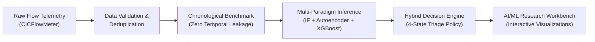

# NETDEFY — Project Overview

> **Tagline:** Detect Anomalies. Understand Network Behaviour.  
> **Status:** AI/ML Research Prototype & Scientific Portfolio Release  
> **Primary Dataset:** CICIDS2017 MachineLearningCSV  
> **Independent Cross-Domain Validation:** CSE-CIC-IDS2018  

---

## 1. Project Purpose & Scope

**NETDEFY (Network Defense Intelligence)** is an open-source, defensive machine learning research platform designed to investigate network anomaly detection, attack classification, and behavioral traffic analysis.

Unlike academic demonstrations that evaluate algorithms on randomly shuffled packet captures, NETDEFY models realistic enterprise security conditions:
- Models are trained strictly on earlier network traffic (Monday–Wednesday) and evaluated on subsequent, unseen days (Thursday–Friday).
- Unsupervised anomaly detectors (Isolation Forest, Deep Autoencoder) establish baselines of normal benign network communication.
- A supervised gradient boosted decision tree (XGBoost) attributes known threats while subjecting candidate alerts to strict decision-margin and entropy checks.
- A four-state Hybrid Decision Engine unites these paradigms into actionable operational verdicts.

> [!NOTE]
> **Research Prototype Scope:** NETDEFY is an applied machine learning research artifact and engineering demonstration platform. It is not an enterprise SOC appliance, does not provide automated offensive counter-measures, and does not claim to prevent zero-day exploits without defensive human review.

---

## 2. Research Objectives & Core Hypotheses

The foundational research question driving NETDEFY is:

> *"How reliably can a network anomaly detection system trained on earlier enterprise traffic detect suspicious activity on subsequent days, and what are the empirical failure modes when subjected to temporal shift, label collisions, and foreign network environments?"*

Throughout the phased development of NETDEFY, six primary scientific hypotheses were formulated and experimentally evaluated:

1. **Temporal Generalization:** Detection performance collapses when models are evaluated chronologically rather than randomly, primarily because benign network communication patterns naturally drift across recording sessions.
2. **False Alarm Budgets in High-Throughput Networks:** In high-volume environments carrying millions of flows daily, a nominal 1% false positive rate causes intolerable alert fatigue. Unsupervised score calibration via empirical cumulative distribution functions (ECDF) is required to suppress false alarms.
3. **Architectural Trade-Offs (Classical Trees vs. Deep Autoencoders):** A non-linear PyTorch Autoencoder ($76 \to 32 \to 16 \to 32 \to 76$) significantly outperforms classical Isolation Forest trees in PR-AUC under temporal shift, at the cost of higher latency ($1.84\text{ ms}$ vs. $1.12\text{ ms}$).
4. **Supervised Open-Set Blindness:** Supervised GBDT classifiers achieve near-perfect accuracy ($99.67\%$) on closed-set validation, but completely miss unseen attack categories ($71.72\%$ misclassified as benign) unless guarded by unsupervised anomaly gating.
5. **Impact of Label Collisions in Packet Captures:** Dual-homed monitoring taps and SPAN ports generate identical 5-tuples and continuous feature vectors with conflicting ground-truth labels. Identifying and disambiguating these collisions reveals substantial latent model recall ($+35.1\%$ relative gain).
6. **Cross-Environment Degradation:** A model trained on one network topology (CICIDS2017) suffers severe performance degradation when tested on an independent external environment (CSE-CIC-IDS2018), proving that flow-based anomaly detection learns environment-specific artifacts.

---

## 3. Key Design Decisions

### 3.1 Strict Chronological Partitioning (No Random Shuffling)
Random train/test splits inadvertently leak future temporal structure into training weights, producing artificially inflated metrics. NETDEFY mandates chronological splitting:
- **`oneclass_train` ($100,000$ flows):** Monday (pure benign traffic).
- **`classifier_train` ($30,000$ flows):** Tuesday & Wednesday (8 classes: Benign, DoS, Brute Force).
- **`validation` ($20,000$ flows):** Tuesday & Wednesday (disjoint flows for calibration).
- **`test` ($50,000$ flows):** Thursday & Friday (full holdout evaluating 14 attack classes).

### 3.2 Dual-View Benchmark (Full View A vs. Disambiguated View B)
During forensic dataset inspection, $3,305$ test flows ($3,254$ PortScan, $49$ Benign, $2$ Bot) were discovered to share identical 76-feature continuous vectors across conflicting ground-truth labels. Rather than silently dropping or modifying these rows, NETDEFY maintains two explicit evaluation views:
- **View A ($50,000$ flows):** Unadjusted real-world benchmark reflecting raw capture imperfections.
- **View B ($46,695$ flows):** Disambiguated benchmark excluding collision rows to measure true algorithmic capability.

### 3.3 Four-State Operational Decision Policy
Instead of reducing model evaluation to a single continuous scalar or naive cutoff, NETDEFY implements a four-state triage decision engine:
1. **`NORMAL`:** Flow exhibits nominal benign behavior across all detectors.
2. **`SUSPICIOUS_KNOWN`:** High-confidence anomaly attributed to a known training attack with verified decision margin and low entropy.
3. **`SUSPICIOUS_UNKNOWN`:** High anomaly score, but classifier signals low confidence, high entropy, or attribution to benign (identifying novel threats, zero-days, or open-set attacks).
4. **`REVIEW_REQUIRED`:** Detector disagreement (e.g., Autoencoder flags anomaly while Isolation Forest does not) or borderline scores requiring manual analyst verification.

### 3.4 Grounded Explainability
NETDEFY rejects ungrounded approximations (such as raw Kernel SHAP on millions of flows) in favor of model-native explanations:
- **Autoencoder Feature Residuals:** Identifies specific feature dimensions with the highest reconstruction error: $e_j = (x_j - \hat{x}_j)^2$.
- **XGBoost Split Gain:** Quantifies feature contribution using exact average loss reduction across tree splits.

---

## 4. Key Verified Research Results

| Evaluation Dimension | Isolation Forest | Deep Autoencoder | XGBoost (Supervised) | NETDEFY Hybrid Engine |
| :--- | :---: | :---: | :---: | :---: |
| **Model Paradigm** | Unsupervised Trees | PyTorch Latent Bottleneck | Gradient Boosted Trees | Multi-Paradigm Ensemble |
| **Holdout AUROC (View A)** | $0.6558$ | $0.8307$ | $0.8505$ (Binary Prob) | **$0.7377$** (Continuous Fusion) |
| **Holdout PR-AUC (View A)** | $0.3423$ | $0.6021$ | $0.6745$ (Binary Prob) | **$0.4318$** (Continuous Fusion) |
| **Operational Precision** | $51.06\%$ | $75.42\%$ | $97.31\%$ | **$84.73\%$** |
| **Attack Escalation Recall** | $6.54\%$ | $28.65\%$ | $28.29\%$ | **$27.73\%$** ($37.46\%$ View B) |
| **Operational F1 Score** | $0.1159$ | $0.4153$ | $0.4383$ | **$0.4178$** ($0.5196$ View B) |
| **False Alarms / 1,000 Benign** | $20.95$ | $31.22$ | $2.62$ | **$16.70$ (-46.5% vs AE)** |
| **Inference Latency (M3)** | **$1.12\text{ ms}$** | $1.84\text{ ms}$ | $1.25\text{ ms}$ | $4.86\text{ ms}$ |

---

## 5. Repository Documentation Directory

For complete technical specifications, consult the dedicated documentation sections:
- [Architecture & System Design](ARCHITECTURE.md)
- [Model Methodology & Mathematical Formulations](MODEL_METHODOLOGY.md)
- [Experimental Methodology & Data Integrity](EXPERIMENTAL_METHODOLOGY.md)
- [Results, Findings & Discrepancy Reconciliation](RESULTS_AND_FINDINGS.md)
- [Scientific Limitations & Boundaries](LIMITATIONS.md)
- [API Reference & Schema Specification](API_REFERENCE.md)
- [Reproducibility & Verification Guide](REPRODUCIBILITY.md)
- [Developer & Quality Assurance Standards](DEVELOPMENT.md)
