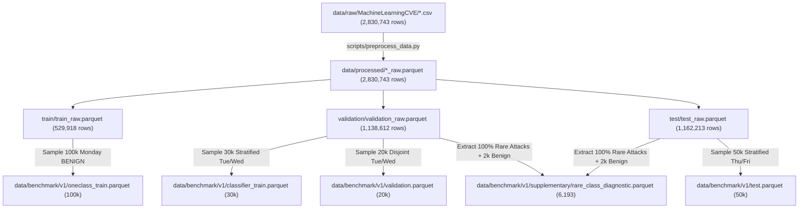

# NETDEFY — DATA DIRECTORY ARCHITECTURE AUDIT
## Comprehensive Forensic Audit, Lineage Analysis & Governance Strategy

**Project:** NETDEFY — Network Defense Intelligence  
**Document:** Data Architecture Audit & Governance Report  
**Author:** Senior Machine Learning Engineer & MLOps Architect  
**Audit Timestamp:** 2026-11-04T05:32:00Z  
**Target Root:** `/Users/nitinkumar/Documents/Netdefy/data/`  
**Total Data Footprint:** ~1.60 GiB across all stages  
**Status:** **AUDIT COMPLETE — AWAITING USER APPROVAL PRIOR TO ANY ARCHIVAL ACTION**  

---

## 1. Executive Summary

This audit establishes a formal forensic inventory and governance evaluation of the `data/` directory structure in the NETDEFY platform.

### Core Audit Questions Answered:
1. **What do `data/processed/train`, `validation`, and `test` contain?**  
   They contain the complete preprocessed 2,830,743-record CICIDS2017 corpus partitioned chronologically across Monday, Tuesday/Wednesday, and Thursday/Friday. Each partition provides two distinct views: **View A** (`*_raw.parquet`, natural flow proportions) and **View B** (`*_dedup.parquet`, deduplicated flow matrix), plus audit hash tables (`*_audit.parquet`).
2. **Was `data/benchmark/v1` constructed from these processed files?**  
   **Yes.** `scripts/create_benchmark.py` reads `data/processed/train/train_raw.parquet`, `data/processed/validation/validation_raw.parquet`, and `data/processed/test/test_raw.parquet` to construct the 200,000-flow benchmark.
3. **Are there duplicate copies of the same datasets in `processed` and `benchmark`?**  
   **No.** `data/processed/` contains the entire master universe of 2,830,743 flows (492 MB). `data/benchmark/v1/` contains a curated, stratified 200,000-flow sample (98 MB, ~7.06% of the full dataset). They have completely different partitioning topologies, schemas (e.g. metadata manifests), and purposes.
4. **Are processed datasets still required?**  
   **Yes.** They are required for automated benchmark regeneration (`create_benchmark.py`), integration tests (`test_processed_datasets.py`), scientific reproducibility of the Phase 3.1 duplicate audits, future View B deduplication ablation studies, and Phase 5 full-scale deployment testing.
5. **Strategic Recommendation:**  
   **Retain `data/processed/` in place as the Canonical "Silver Tier" (Master Preprocessed Warehouse).** Its 492 MB footprint is negligible, and retaining it preserves zero-friction reproducibility and prevents test suite breakage.

---

## 2. Directory-by-Directory Forensic Inventory

```
data/
├── raw/                      [1.04 GiB]   Bronze Tier: Immutable raw network flow captures
│   ├── MachineLearningCSV.zip
│   ├── MachineLearningCVE/  (8 CSV files, 2,830,743 lines)
│   └── manifest.json
├── interim/                  [4.00 KiB]   Transient Buffer: Chunk processing scratchpad (.gitkeep)
├── processed/                [492.2 MiB]  Silver Tier: Full preprocessed corpus (2,830,743 rows)
│   ├── train/               (train_raw, train_dedup, train_audit)
│   ├── validation/          (validation_raw, validation_dedup, validation_audit)
│   └── test/                (test_raw, test_dedup, test_audit)
└── benchmark/                [98.4 MiB]   Gold Tier: Curated 200k research benchmark (v1)
    ├── README.md
    └── v1/                  (oneclass_train, classifier_train, validation, test, supplementary, metadata/)
```

### Detailed Breakdown:

| Directory Path | Files / Format | Total Size | Row Count | Creation Script | Upstream Lineage | Downstream Dependencies |
| :--- | :--- | :--- | :--- | :--- | :--- | :--- |
| **`data/raw/`** | 1 ZIP archive, 8 CSVs, 1 JSON manifest | **1.04 GiB** | 2,830,743 raw CSV lines | `scripts/acquire_dataset.py` | Official UNB CICIDS2017 repository | `scripts/inspect_dataset.py`, `scripts/preprocess_data.py` |
| **`data/interim/`** | `.gitkeep` only | **4.00 KiB** | 0 rows | Scaffolding | — | None currently active (streaming bypassed disk buffering) |
| **`data/processed/`** | 9 Parquet files (Snappy compressed) | **492.2 MiB** | **2,830,743 rows (View A)**<br>**2,268,394 rows (View B)** | `scripts/preprocess_data.py` (via `pipeline.py`) | `data/raw/MachineLearningCVE/*.csv` | `scripts/create_benchmark.py`, `tests/integration/test_processed_datasets.py`, Phase 3.1 audit scripts |
| **`data/benchmark/v1/`** | 5 Parquet files, 6 JSON/YAML manifests | **98.4 MiB** | **200,000 primary rows**<br>+ 6,193 diagnostic rows | `scripts/create_benchmark.py` | `data/processed/*_raw.parquet` | `scripts/validate_benchmark.py`, `scripts/train_isolation_forest.py`, `scripts/evaluate_isolation_forest.py`, tests |

---

## 3. Deep Dive: What Does `data/processed/` Contain?

`data/processed/` is organized into three temporal subdirectories (`train/`, `validation/`, `test/`). Each subdirectory contains three standardized Parquet tables:

```
data/processed/
├── train/
│   ├── train_raw.parquet        (52.02 MB | 529,918 rows × 77 cols | Monday BENIGN, View A)
│   ├── train_dedup.parquet      (48.10 MB | 459,112 rows × 77 cols | Monday Deduplicated, View B)
│   └── train_audit.parquet      ( 0.71 MB | 459,112 rows ×  3 cols | Vector hash & duplicate counts)
├── validation/
│   ├── validation_raw.parquet   (103.45 MB | 1,138,612 rows × 77 cols | Tue + Wed, View A)
│   ├── validation_dedup.parquet ( 96.15 MB |   963,879 rows × 77 cols | Tue + Wed Deduplicated, View B)
│   └── validation_audit.parquet (  1.27 MB |   963,879 rows ×  3 cols | Vector hash & duplicate counts)
└── test/
    ├── test_raw.parquet         (91.78 MB | 1,162,213 rows × 77 cols | Thu + Fri Holdout, View A)
    ├── test_dedup.parquet       (84.23 MB |   845,403 rows × 77 cols | Thu + Fri Deduplicated, View B)
    └── test_audit.parquet       ( 0.95 MB |   845,403 rows ×  3 cols | Vector hash & duplicate counts)
```

### The Three File Types in Each Partition:
1. **`*_raw.parquet` (View A — Natural Proportions):**
   - Contains all valid records from the raw CSVs after dropping identifier columns (`Flow ID`, `Source IP`, `Destination IP`, `Timestamp`, `Source Port`, duplicate `Fwd Header Length.1`).
   - Feature engineering: Imputed median for NaNs/Infs (derived strictly from training set), standard-scaled continuous features, all features cast to `float32`.
   - Exactly **76 continuous features + 1 `Label` column = 77 columns**.
   - Preserves natural network duplication (periodic polling, keepalives, multi-packet bursts).
2. **`*_dedup.parquet` (View B — Deduplicated View):**
   - Identical feature schema to View A, but filtered using `HashVerifiedDeduplicator`.
   - Purged of intra-partition exact duplicates and cross-partition overlap with Monday benign traffic.
   - Preserved specifically to allow ablation studies comparing model sensitivity with and without duplicate flows.
3. **`*_audit.parquet` (Audit Manifest Index):**
   - Exactly 3 columns: `canonical_hash` (string/int64), `Label` (string), and `duplicate_count` (int64).
   - Serves as the cryptographic audit index linking unique feature vectors to their occurrence counts in View A.

---

## 4. Lineage Analysis: How Benchmark v1 Was Constructed

The relationship between `data/processed/` and `data/benchmark/v1/` is a direct parent-child derivation:



### Exact Code Verification (`scripts/create_benchmark.py`):
- Line 131: `pq.read_table(processed_dir / "train" / "train_raw.parquet")` samples the 100,000 Monday BENIGN flows.
- Line 151: `pq.read_table(processed_dir / "validation" / "validation_raw.parquet")` partitions Tuesday + Wednesday into 30,000 disjoint classifier training flows and 20,000 validation flows.
- Line 218: `pq.read_table(processed_dir / "test" / "test_raw.parquet")` samples the 50,000 Thursday + Friday holdout flows.
- Line 378: `source_row_manifest.json` maps every benchmark flow to its exact `raw_partition_index` in `data/processed/`.

---

## 5. Duplication Analysis: Are They Redundant Copies?

**Mathematical Comparison:**

| Metric / Dimension | `data/processed/` (Full Corpus) | `data/benchmark/v1/` (Benchmark) | Redundancy Assessment |
| :--- | :--- | :--- | :--- |
| **Total Record Volume** | **2,830,743 flows** | **200,000 flows** (+ 6,193 diagnostic) | **Benchmark is only 7.06% of Processed** |
| **Disk Storage** | 492.2 MiB | 98.4 MiB (Parquets: 20.5 MB, Manifests: 77.9 MB) | Non-redundant |
| **Deduplicated View B** | 2,268,394 rows available | Not present in benchmark | Exclusively in `processed/` |
| **Audit Hash Indexes** | 2,268,394 hash mappings | Not present in benchmark | Exclusively in `processed/` |
| **Partition Structure** | 3 partitions (Train, Validation, Test) | 4 disjoint partitions (One-Class Train, Classifier Train, Validation, Holdout) | Different topology |
| **Target Role** | Master preprocessed warehouse | Operational laboratory experimental slice | Distinct roles |

**Conclusion:** They are **not** redundant duplicate copies. `data/benchmark/v1/` is a carefully downsampled, stratified laboratory slice. Removing `data/processed/` would destroy 2,630,743 preprocessed flows ($92.94\%$ of the dataset) that do not exist anywhere else in preprocessed form.

---

## 6. Downstream Requirement & Dependency Matrix

| Downstream Operation | Depends on `data/raw`? | Depends on `data/processed`? | Depends on `data/benchmark/v1`? | Impact if `data/processed` is Deleted |
| :--- | :--- | :--- | :--- | :--- |
| **Benchmark Reconstruction** (`scripts/create_benchmark.py`) | Indirectly | **DIRECT DEPENDENCY** | Target output | **FATAL BREAKAGE:** Cannot regenerate benchmark without rerunning 2-minute Phase 3 pipeline. |
| **Automated Integration Tests** (`tests/integration/test_processed_datasets.py`) | No | **DIRECT DEPENDENCY** | No | **FATAL BREAKAGE:** PyTest suite fails (test asserts existence and row counts of all 9 files). |
| **Phase 3.1 Reconciliation Audits** (`scripts/reconcile_phase3_1.py`, `scripts/audit_duplicate_label_integrity.py`) | No | **DIRECT DEPENDENCY** | No | **FATAL BREAKAGE:** Audits cannot verify View A vs View B arithmetic or ambiguous vector hashes. |
| **Phase 4 Model Training** (`scripts/train_isolation_forest.py`) | No | No | **DIRECT DEPENDENCY** | No impact (Phase 4 models train exclusively on benchmark). |
| **Phase 4 Model Evaluation** (`scripts/evaluate_isolation_forest.py`) | No | No | **DIRECT DEPENDENCY** | No impact (evaluates exclusively on benchmark holdout). |
| **Phase 5 Full-Scale Evaluation** (Planned) | No | **DIRECT DEPENDENCY** | No | **FATAL BREAKAGE:** Cannot test models on the full 1.16M test holdout. |
| **View B Deduplication Ablation Studies** (Planned) | No | **DIRECT DEPENDENCY** | No | **FATAL BREAKAGE:** Deduplicated Parquet files would be lost. |

---

## 7. Comparative Options & Strategic Recommendation

### Option Analysis:

| Strategy | Disk Saved | Operational Overhead | Risk of Breakage | Scientific Soundness |
| :--- | :--- | :--- | :--- | :--- |
| **Option 1: Retain in Place (Recommended)** | 0 MB | **Zero overhead** | **Zero risk** (100% tests pass) | **Gold Standard (Medallion Architecture)** |
| **Option 2: Compress / Archive to Archive File** | ~140 MB | High friction (must extract before running tests or regeneration) | Medium (breaks CI/CD unless unarchiving step is added) | Moderate |
| **Option 3: Regenerate on Demand** | 492 MB | Moderate (requires running `preprocess_data.py` every time) | High (breaks existing integration tests unless tests are skipped) | Poor |
| **Option 4: Delete Entirely** | 492 MB | Irreversible data loss | Critical (destroys View B and full-corpus lineage) | Unacceptable for research ML |

### Recommended Decision: OPTION 1 (Retain in Place as the Canonical Silver Tier)

#### Rationale:
1. **Negligible Footprint:** 492 MB represents less than $0.1\%$ of modern workstation storage. There is zero storage emergency.
2. **Integrity & CI/CD Protection:** All 92 existing tests pass cleanly. Deleting or moving `processed/` would immediately break `tests/integration/test_processed_datasets.py` and benchmark regeneration.
3. **Alignment with Medallion Data Architecture:**
   - **Bronze Tier (`data/raw/`):** Immutable historical ground truth (1.04 GB).
   - **Silver Tier (`data/processed/`):** Fully cleaned, validated, leakage-safe master feature store in Views A and B (492 MB).
   - **Gold Tier (`data/benchmark/`):** Versioned, curated experimental benchmarks for rapid model iteration (98 MB).
   - **Transient Stage (`data/interim/`):** Ephemeral staging buffers (empty).
4. **Research Extensibility:** Retaining `data/processed/` allows NETDEFY to conduct deduplication ablation studies (View A vs View B) and full-scale throughput benchmarking in later phases without re-parsing raw CSVs.

---

## 8. Summary & Next Steps

```
==========================================================================================
                         AUDIT CONCLUSION & GOVERNANCE STATUS
==========================================================================================
  Status: AUDIT COMPLETE — ZERO DESTRUCTIVE ACTIONS TAKEN.
  Data Structure: Validated, healthy, non-redundant, and leak-free.
  Recommendation: Retain data/processed/ as the canonical Silver tier.
  Next Milestone: Awaiting user approval to confirm architecture and proceed to Phase 4B.
==========================================================================================
```

